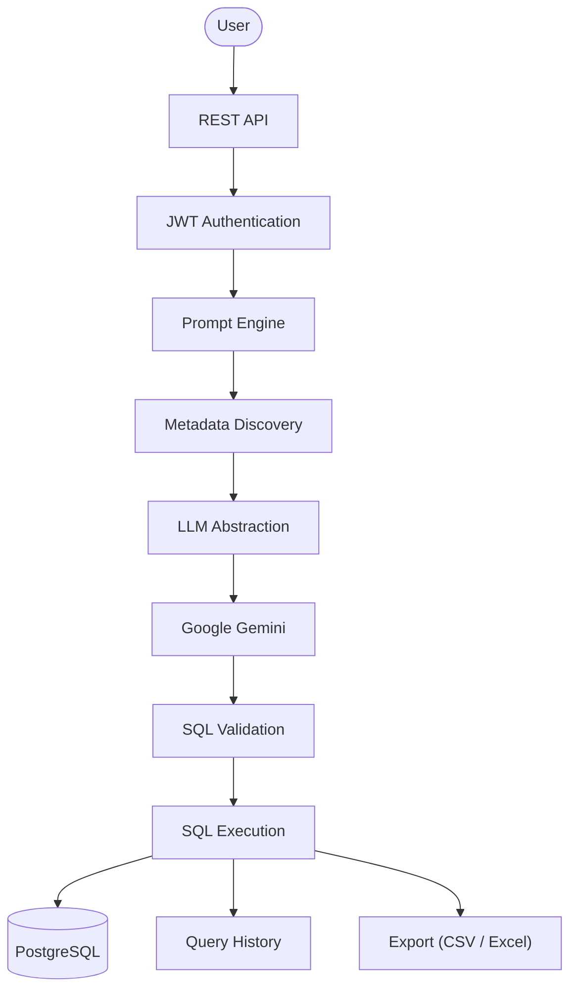
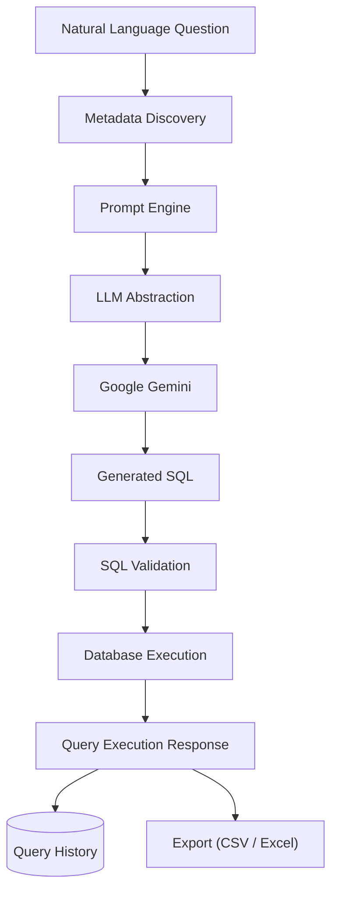
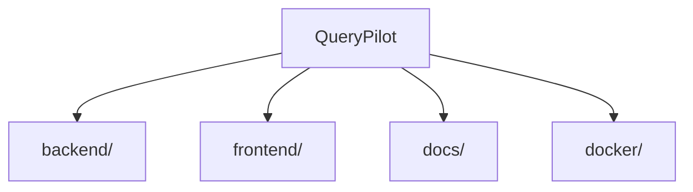

# QueryPilot

**Enterprise-grade, AI-powered Natural Language to SQL platform.**


QueryPilot lets users query relational databases in plain English. It is built on a modern Spring Boot backend designed around enterprise conventions — layered architecture, centralized error handling, JWT authentication, and a security-first foundation — with a metadata-aware prompt engineering layer, Google Gemini generating SQL directly from natural language questions, and a full execution, history, and export pipeline behind it.

---

## Why QueryPilot?

- **Natural language to SQL** — describe the data you want, and QueryPilot generates, validates, and executes the SQL for you.
- **AI-powered generation** — a metadata-aware Prompt Engine and Google Gemini turn plain English into SQL, not hand-written templates.
- **PostgreSQL-aware** — SQL is grounded in real, live-discovered database metadata, not assumed schema.
- **Safe by construction** — every generated statement passes through SQL validation before it is ever allowed to execute.
- **Enterprise architecture** — a conventional, layered Spring Boot structure that scales with the team.
- **Secure by design** — JWT authentication protects every endpoint beyond registration and login.
- **Extensible core** — infrastructure (responses, exceptions, security, constants, the LLM and database-execution abstractions) is built once and reused by every feature that follows.
- **Self-documenting API** — a full OpenAPI/Swagger UI is generated directly from the live backend.

---

## Features

### Implemented

| Area | Capability |
|---|---|
| ✔ | Java 21 / Spring Boot 3 REST API |
| ✔ | Enterprise package structure (`client`, `config`, `service`, `security`, `exception`, `export`, …) |
| ✔ | Spring Security foundation (stateless, CSRF-disabled filter chain) |
| ✔ | JWT authentication |
| ✔ | User registration and login |
| ✔ | Global exception handling (`@RestControllerAdvice`) |
| ✔ | Generic API response envelope |
| ✔ | PostgreSQL metadata discovery |
| ✔ | Prompt Engine (metadata-aware prompt construction) |
| ✔ | Google Gemini integration |
| ✔ | AI-powered SQL generation |
| ✔ | SQL validation (read-only, single-statement enforcement) |
| ✔ | SQL execution against PostgreSQL |
| ✔ | Query history (auto-recorded on every successful execution) |
| ✔ | Saved queries (independent of history) |
| ✔ | Query result export (CSV and Excel) |
| ✔ | OpenAPI / Swagger UI documentation |

### Planned

| Area | Capability |
|---|---|
| ○ | Angular frontend |
| ○ | Docker deployment |

---

## Current Capabilities

QueryPilot's backend can currently:

- Authenticate users with JWT-based access tokens.
- Register and manage user accounts.
- Discover PostgreSQL database metadata (schemas, tables, columns, keys) at runtime.
- Generate metadata-aware, structured prompts for SQL generation.
- Generate SQL from natural language questions using Google Gemini.
- Validate generated SQL, rejecting anything that is not a single, read-only `SELECT` statement.
- Execute validated SQL against PostgreSQL and return typed results (columns, rows, row count, execution time).
- Automatically record every successful execution in a per-user query history.
- Let users save, rename, and delete queries for future reuse, independent of history.
- Export a query's results as CSV or as an Excel (`.xlsx`) workbook.
- Talk to LLM providers through a provider-neutral `LLMClient` abstraction, and to databases through a provider-neutral `DatabaseClient` abstraction, so adding or swapping either requires no changes to calling services.
- Serve every capability through a consistent, JWT-secured REST API with a uniform response envelope, documented live via Swagger UI.

---

## High-Level Architecture



Every stage above is implemented today. Query history is recorded automatically on every successful execution; export and saved queries are available as separate, independent capabilities built on the same execution pipeline.

---

## AI Query Generation & Execution Pipeline



A user's question is paired with live PostgreSQL metadata (schemas, tables, columns, keys) by the Prompt Engine, which assembles a structured, metadata-grounded prompt. That prompt is submitted through the provider-neutral `LLMClient` abstraction — implemented today by `GeminiClient` — and the SQL Google Gemini returns is validated (single, read-only `SELECT` only) before it is ever executed. Execution goes through the provider-neutral `DatabaseClient` abstraction — implemented today by `PostgresDatabaseClient` — and every successful run is automatically recorded in query history. Results can additionally be exported as CSV or Excel on demand.

---

## Repository Structure



| Folder | Purpose |
|---|---|
| [`backend/`](backend/README.md) | Spring Boot backend — application code, configuration, and tests |
| `frontend/` | Angular client application (not yet started) |
| `docs/` | Project documentation — HLD, LLD, API reference, roadmap (added incrementally) |
| `docker/` | Container and deployment configuration (not yet started) |

### Backend Package Layout

`backend/src/main/java/com/querypilot/`

| Package | Responsibility |
|---|---|
| `client` | Outbound clients for external integrations — `LLMClient` / `GeminiClient`, `MetadataClient` / `PostgresMetadataClient`, `DatabaseClient` / `PostgresDatabaseClient` |
| `config` | Spring configuration and `@ConfigurationProperties` (JWT, Gemini, OpenAPI) |
| `constant` | Centralized application, API, and security constants |
| `controller` | REST controllers (`AuthController`, `MetadataController`, `PromptController`, `QueryController`, `QueryHistoryController`, `SavedQueryController`) |
| `dto` | Request/response DTOs, kept provider- and layer-neutral |
| `entity` | JPA entities |
| `exception` | Custom exceptions and the global `@RestControllerAdvice` handler |
| `export` | Plain, dependency-free CSV/Excel renderers (`CsvExporter`, `ExcelExporter`) — not Spring beans |
| `mapper` | Entity ↔ DTO mapping |
| `prompt` | Prompt construction logic for the Prompt Engine |
| `repository` | Spring Data JPA repositories |
| `security` | Spring Security configuration and the JWT filter chain |
| `service` | Business logic interfaces and implementations |
| `util` | Shared utilities |
| `validator` | SQL validation (`SQLValidator` / `DefaultSQLValidator`) |

See [`backend/README.md`](backend/README.md) for the backend's internal package layout, configuration, and run instructions.

---

## Technology Stack

**Backend**

| Concern | Choice |
|---|---|
| Language | Java 21 |
| Framework | Spring Boot |
| Security | Spring Security |
| Persistence | Spring Data JPA |
| API Documentation | springdoc-openapi (Swagger UI) |
| Spreadsheet Export | Apache POI |

**Database**

| Concern | Choice |
|---|---|
| Primary | PostgreSQL |
| Testing | H2 (in-memory) |

**Authentication**

| Concern | Choice |
|---|---|
| Mechanism | JWT |

**AI**

| Concern | Choice |
|---|---|
| Provider | Google Gemini |

**Build**

| Concern | Choice |
|---|---|
| Tool | Maven |

---

## Development Roadmap

**Completed**

- ✓ Sprint 1.1 – Foundation
- ✓ Sprint 1.2 – Infrastructure & Security
- ✓ Sprint 1.3 – User Management
- ✓ Sprint 1.4 – Authentication
- ✓ Sprint 1.5 – JWT Authentication
- ✓ Sprint 1.6 – Metadata Discovery
- ✓ Sprint 1.7 – Prompt Engine
- ✓ Sprint 1.8 – Gemini Integration
- ✓ Sprint 1.9 – SQL Validation
- ✓ Sprint 2.0 – SQL Execution
- ✓ Sprint 2.1 – Query History
- ✓ Sprint 2.2 – Saved Queries
- ✓ Sprint 2.3 – Export Query Results
- ✓ v2.4 RC – Backend Stabilization & OpenAPI Documentation

**Upcoming**

- Angular Frontend
- Deployment (Docker)

---

## Project Status

**Current version:** v2.4-RC (Release Candidate)
**Progress:** Backend feature-complete for the initial release; frontend integration is next.

The backend platform is complete end-to-end: authentication, metadata discovery, AI-powered SQL generation, validation, execution, query history, saved queries, and result export are all implemented and working together behind a single, JWT-secured, OpenAPI-documented REST API. This release candidate focused on stabilization — API consistency, exception-handling review, DTO review, code cleanup, and Swagger documentation — in preparation for Angular frontend integration.

---

## API Documentation

With the backend running, the full interactive API reference is available at:

- Swagger UI: `http://localhost:8080/swagger-ui/index.html`
- Raw OpenAPI document: `http://localhost:8080/v3/api-docs`

Every endpoint except `/api/v1/auth/register` and `/api/v1/auth/login` requires a JWT bearer token — obtain one via `/api/v1/auth/login` and use Swagger UI's **Authorize** button to apply it to subsequent requests.

---

## Documentation

Project documentation lives in [`docs/`](docs/). Detailed material — High-Level Design, Low-Level Design, API reference, security model, deployment guide, and roadmap — will be added gradually as development progresses.

---

## Getting Started

```sh
# Clone the repository
git clone https://github.com/the-illuminatus/Spring_backend_based_NLP-AI.git
cd Spring_backend_based_NLP-AI/backend

# Build
mvn clean install

# Run
mvn spring-boot:run
```

For configuration, environment variables, and database setup, see [`backend/README.md`](backend/README.md).

---

## Contributing

Contributions are welcome. If you're interested in helping shape QueryPilot, please open an issue to discuss the change before submitting a pull request.

---

## License

Distributed under the MIT License.
