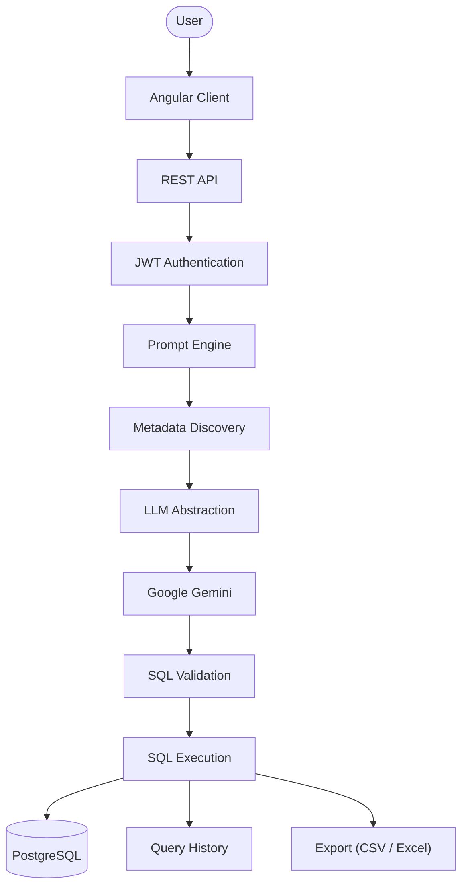
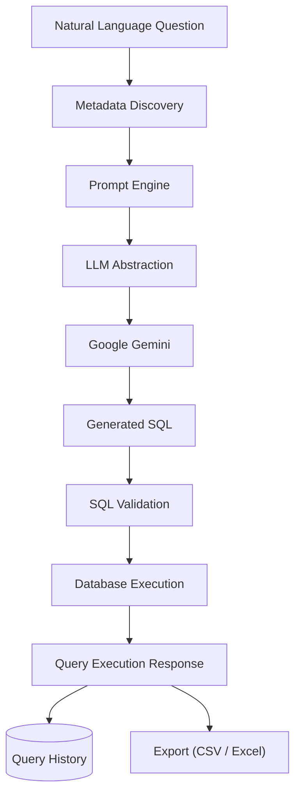
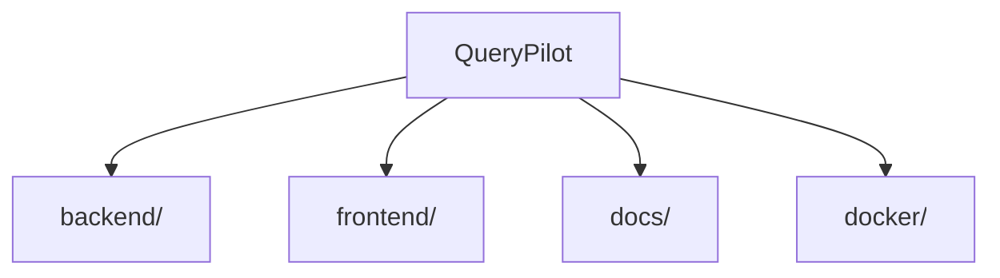

# QueryPilot

**Enterprise-grade, AI-powered Natural Language to SQL platform.**


QueryPilot lets users query relational databases in plain English. It is built on a modern Spring Boot backend designed around enterprise conventions — layered architecture, centralized error handling, JWT authentication, and a security-first foundation — with a metadata-aware prompt engineering layer, Google Gemini generating SQL directly from natural language questions, and a full execution, history, and export pipeline behind it. That backend is now fronted by a complete Angular + Angular Material client — login/registration, a query console, dashboard, history, saved queries, and profile — giving QueryPilot a genuine end-to-end natural language to SQL experience.

---

## Table of Contents

- [Why QueryPilot?](#why-querypilot)
- [Features](#features)
- [Feature Deep Dive](#feature-deep-dive)
- [Current Capabilities](#current-capabilities)
- [High-Level Architecture](#high-level-architecture)
- [AI Query Generation & Execution Pipeline](#ai-query-generation--execution-pipeline)
- [Repository Structure](#repository-structure)
- [Technology Stack](#technology-stack)
- [Development Roadmap](#development-roadmap)
- [Project Status](#project-status)
- [API Documentation](#api-documentation)
- [Security](#security)
- [Screenshots](#screenshots)
- [Documentation](#documentation)
- [Setup Guide](#setup-guide)
- [Contributing](#contributing)
- [License](#license)

---

## Why QueryPilot?

- **Natural language to SQL** — describe the data you want, and QueryPilot generates, validates, and executes the SQL for you.
- **AI-powered generation** — a metadata-aware Prompt Engine and Google Gemini turn plain English into SQL, not hand-written templates.
- **PostgreSQL-aware** — SQL is grounded in real, live-discovered database metadata, not assumed schema.
- **Safe by construction** — every generated statement passes through SQL validation before it is ever allowed to execute.
- **Enterprise architecture** — a conventional, layered Spring Boot structure that scales with the team.
- **Secure by design** — JWT authentication protects every endpoint beyond registration and login.
- **Extensible core** — infrastructure (responses, exceptions, security, constants, the LLM and database-execution abstractions) is built once and reused by every feature that follows.
- **Self-documenting API** — a full OpenAPI/Swagger UI is generated directly from the live backend.
- **Full-stack delivery** — a complete Angular Material client (dashboard, query console, history, saved queries, profile) sits directly on the secured REST API, so the platform is usable end-to-end, not just via API calls.

---

## Features

### Implemented

| Area | Capability |
|---|---|
| ✔ | Java 21 / Spring Boot 3 REST API |
| ✔ | Enterprise package structure (`client`, `config`, `service`, `security`, `exception`, `export`, …) |
| ✔ | Spring Security foundation (stateless, CSRF-disabled filter chain) |
| ✔ | JWT authentication |
| ✔ | User registration and login |
| ✔ | BCrypt password encryption |
| ✔ | Global exception handling (`@RestControllerAdvice`) |
| ✔ | Generic API response envelope |
| ✔ | PostgreSQL metadata discovery |
| ✔ | Prompt Engine (metadata-aware prompt construction) |
| ✔ | Google Gemini integration |
| ✔ | AI-powered SQL generation |
| ✔ | SQL validation (read-only, single-statement enforcement) |
| ✔ | SQL execution against PostgreSQL |
| ✔ | Query history (auto-recorded on every successful execution) |
| ✔ | Saved queries (independent of history) |
| ✔ | Query result export (CSV and Excel) |
| ✔ | OpenAPI / Swagger UI documentation |
| ✔ | Angular frontend (login, register, dashboard, query console, history, saved queries, profile) |
| ✔ | Angular Material UI, JWT-aware HTTP interceptor, route auth guard |

### Planned

| Area | Capability |
|---|---|
| ○ | Docker deployment |

---

## Feature Deep Dive

### Authentication

- User registration and login via dedicated `/api/v1/auth` endpoints.
- Stateless **JWT authentication** — every endpoint except `/auth/register` and `/auth/login` requires a bearer token.
- **BCrypt** password hashing — plaintext passwords are never stored or logged.
- Backed by a custom Spring Security filter chain (`JwtAuthenticationFilter`, `CustomUserDetailsService`, `CustomAuthenticationEntryPoint`, `CustomAccessDeniedHandler`).

### Backend

- **Spring Boot 3** REST API in a conventional, layered package structure (`controller` → `service` → `repository`/`client`).
- **Spring Security** for authentication and endpoint protection.
- **Spring Data JPA** + **Hibernate** for persistence, with schema kept in sync automatically (`ddl-auto: update` in development).
- **PostgreSQL** as the primary data store, with live schema/metadata discovery used to ground AI-generated SQL.
- Centralized exception handling and a uniform `ApiResponse<T>` envelope across every endpoint.

### AI

- **Google Gemini integration** through a provider-neutral `LLMClient` abstraction (`GeminiClient` is the current implementation).
- **Natural language → SQL**: user questions are combined with live PostgreSQL metadata by the Prompt Engine into a structured, schema-grounded prompt.
- **SQL validation**: every statement returned by Gemini is checked before execution — only a single, read-only `SELECT` is accepted.
- **SQL execution**: validated statements run against PostgreSQL through a provider-neutral `DatabaseClient` abstraction (`PostgresDatabaseClient`), returning typed columns, rows, row count, and execution time.

### Frontend

- **Angular 19** application built on a `core` / `features` / `shared` structure with **Angular Material** components throughout.
- **Login** and **Register** pages for account access.
- **Dashboard** as the landing view after authentication.
- **Query page** — the natural-language query console, including a save-query dialog.
- **History** page with a detail dialog for reviewing past executions.
- **Saved Queries** page with rename and detail dialogs.
- **Profile** page for the authenticated user.
- Cross-cutting concerns handled centrally: an `auth.interceptor.ts` attaches the JWT to outbound requests, and an `auth.guard.ts` protects authenticated routes.

### Query Features

- **Query History** — every successful execution is recorded automatically per user.
- **Saved Queries** — users can save, rename, and delete queries independently of history.
- **CSV Export** — export a query's results as a `.csv` file.
- **Excel Export** — export a query's results as an `.xlsx` workbook (via Apache POI).
- **Swagger** — the full API is explorable and testable live through Swagger UI.

---

## Current Capabilities

QueryPilot can currently:

- Authenticate users with JWT-based access tokens.
- Register and manage user accounts, with passwords stored using BCrypt.
- Discover PostgreSQL database metadata (schemas, tables, columns, keys) at runtime.
- Generate metadata-aware, structured prompts for SQL generation.
- Generate SQL from natural language questions using Google Gemini.
- Validate generated SQL, rejecting anything that is not a single, read-only `SELECT` statement.
- Execute validated SQL against PostgreSQL and return typed results (columns, rows, row count, execution time).
- Automatically record every successful execution in a per-user query history.
- Let users save, rename, and delete queries for future reuse, independent of history.
- Export a query's results as CSV or as an Excel (`.xlsx`) workbook.
- Talk to LLM providers through a provider-neutral `LLMClient` abstraction, and to databases through a provider-neutral `DatabaseClient` abstraction, so adding or swapping either requires no changes to calling services.
- Serve every capability through a consistent, JWT-secured REST API with a uniform response envelope, documented live via Swagger UI.
- Provide a full Angular Material web client — login/registration, a query console, dashboard, history, saved queries, and a profile screen — wired directly to the secured REST API, so the platform is usable end-to-end without calling the API by hand.

---

## High-Level Architecture



Every stage above is implemented today. Query history is recorded automatically on every successful execution; export and saved queries are available as separate, independent capabilities built on the same execution pipeline. The Angular client consumes this API directly, attaching the JWT to every request via an HTTP interceptor.

---

## AI Query Generation & Execution Pipeline



A user's question is paired with live PostgreSQL metadata (schemas, tables, columns, keys) by the Prompt Engine, which assembles a structured, metadata-grounded prompt. That prompt is submitted through the provider-neutral `LLMClient` abstraction — implemented today by `GeminiClient` — and the SQL Google Gemini returns is validated (single, read-only `SELECT` only) before it is ever executed. Execution goes through the provider-neutral `DatabaseClient` abstraction — implemented today by `PostgresDatabaseClient` — and every successful run is automatically recorded in query history. Results can additionally be exported as CSV or Excel on demand.

---

## Repository Structure



| Folder | Purpose |
|---|---|
| [`backend/`](backend/README.md) | Spring Boot backend — application code, configuration, and tests |
| `frontend/` | Angular client application — authentication, dashboard, query console, history, saved queries, and profile |
| `docs/` | Project documentation — HLD, LLD, API reference, roadmap (added incrementally) |
| `docker/` | Container and deployment configuration (not yet started) |

### Backend Package Layout

`backend/src/main/java/com/querypilot/`

| Package | Responsibility |
|---|---|
| `client` | Outbound clients for external integrations — `LLMClient` / `GeminiClient`, `MetadataClient` / `PostgresMetadataClient`, `DatabaseClient` / `PostgresDatabaseClient` |
| `config` | Spring configuration and `@ConfigurationProperties` (JWT, Gemini, OpenAPI) |
| `constant` | Centralized application, API, and security constants |
| `controller` | REST controllers (`AuthController`, `MetadataController`, `PromptController`, `QueryController`, `QueryHistoryController`, `SavedQueryController`) |
| `dto` | Request/response DTOs, kept provider- and layer-neutral |
| `entity` | JPA entities |
| `exception` | Custom exceptions and the global `@RestControllerAdvice` handler |
| `export` | Plain, dependency-free CSV/Excel renderers (`CsvExporter`, `ExcelExporter`) — not Spring beans |
| `mapper` | Entity ↔ DTO mapping |
| `prompt` | Prompt construction logic for the Prompt Engine |
| `repository` | Spring Data JPA repositories |
| `security` | Spring Security configuration and the JWT filter chain |
| `service` | Business logic interfaces and implementations |
| `util` | Shared utilities |
| `validator` | SQL validation (`SQLValidator` / `DefaultSQLValidator`) |

See [`backend/README.md`](backend/README.md) for the backend's internal package layout, configuration, and run instructions.

### Frontend Package Layout

`frontend/src/app/`

| Package | Responsibility |
|---|---|
| `core/guards` | Route protection (`auth.guard.ts`) |
| `core/interceptors` | JWT attachment on outbound HTTP requests (`auth.interceptor.ts`) |
| `core/layout` | Shell components — `navbar`, `sidebar`, `footer`, `main-layout` |
| `core/services` | Application-wide services — `auth`, `query`, `history`, `saved-query`, `notification` |
| `features/auth` | Login and register pages |
| `features/dashboard` | Post-login dashboard page |
| `features/query` | Natural-language query console, including the save-query dialog |
| `features/history` | Query history page and history detail dialog |
| `features/saved-queries` | Saved queries page, with rename and detail dialogs |
| `features/profile` | Authenticated user's profile page |
| `shared/components` | Reusable UI components (e.g. `confirm-dialog`) |
| `shared/models` | TypeScript models shared across features (auth, query, history, saved query, API response) |
| `shared/utils` | Shared utilities — download handling, cell formatting, HTTP error parsing, JWT decoding |

---

## Technology Stack

**Backend**

| Concern | Choice |
|---|---|
| Language | Java 21 |
| Framework | Spring Boot |
| Security | Spring Security |
| Persistence | Spring Data JPA |
| API Documentation | springdoc-openapi (Swagger UI) |
| Spreadsheet Export | Apache POI |

**Frontend**

| Concern | Choice |
|---|---|
| Framework | Angular |
| UI Components | Angular Material |
| Language | TypeScript |
| Reactive Programming | RxJS |

**Database**

| Concern | Choice |
|---|---|
| Primary | PostgreSQL |
| Testing | H2 (in-memory) |

**Authentication**

| Concern | Choice |
|---|---|
| Mechanism | JWT |
| Password Hashing | BCrypt |

**AI**

| Concern | Choice |
|---|---|
| Provider | Google Gemini |

**Build**

| Concern | Choice |
|---|---|
| Backend | Maven |
| Frontend | Angular CLI / npm |

---

## Development Roadmap

**Completed**

- ✓ Sprint 1.1 – Foundation
- ✓ Sprint 1.2 – Infrastructure & Security
- ✓ Sprint 1.3 – User Management
- ✓ Sprint 1.4 – Authentication
- ✓ Sprint 1.5 – JWT Authentication
- ✓ Sprint 1.6 – Metadata Discovery
- ✓ Sprint 1.7 – Prompt Engine
- ✓ Sprint 1.8 – Gemini Integration
- ✓ Sprint 1.9 – SQL Validation
- ✓ Sprint 2.0 – SQL Execution
- ✓ Sprint 2.1 – Query History
- ✓ Sprint 2.2 – Saved Queries
- ✓ Sprint 2.3 – Export Query Results
- ✓ v2.4 RC – Backend Stabilization & OpenAPI Documentation
- ✓ Angular Frontend – Full client implementation (authentication, dashboard, query console, history, saved queries, profile)

**Upcoming**

- Deployment (Docker)

---

## Project Status

**Current version:** v2.4-RC (Release Candidate)
**Progress:** Backend and frontend feature-complete for the initial release.

The platform is now complete end-to-end: authentication, metadata discovery, AI-powered SQL generation, validation, execution, query history, saved queries, and result export are all implemented on the backend and are all reachable through a complete Angular Material frontend — login/registration, dashboard, query console, history, saved queries, and profile. The backend release candidate focused on stabilization — API consistency, exception-handling review, DTO review, code cleanup, and Swagger documentation — and the Angular client has since been built directly on top of that stabilized API.

---

## API Documentation

With the backend running, the full interactive API reference is available at:

- Swagger UI: `http://localhost:8080/swagger-ui/index.html`
- Raw OpenAPI document: `http://localhost:8080/v3/api-docs`

Every endpoint except `/api/v1/auth/register` and `/api/v1/auth/login` requires a JWT bearer token — obtain one via `/api/v1/auth/login` and use Swagger UI's **Authorize** button to apply it to subsequent requests.

---

## Security

- **BCrypt** hashing for every stored password — plaintext passwords are never persisted or logged.
- **JWT authentication** secures every endpoint beyond registration and login, enforced by a dedicated Spring Security filter chain.
- **Environment-variable-driven secrets** — the database password, JWT secret, and Gemini API key are supplied exclusively via environment variables; nothing sensitive is hardcoded or committed.
- **SQL validation before execution** — every statement returned by Gemini is checked by `SQLValidator`, and only a single, read-only `SELECT` statement is permitted; anything else is rejected before it ever reaches the database.
- **Stateless sessions** — no server-side session state; every request is authenticated independently via its bearer token.

---

## Screenshots

## Login

(Add Screenshot)

## Dashboard

(Add Screenshot)

## Query Generation

(Add Screenshot)

## Results

(Add Screenshot)

## History

(Add Screenshot)

## Saved Queries

(Add Screenshot)

## Profile

(Add Screenshot)

---

## Documentation

Project documentation lives in [`docs/`](docs/). Detailed material — High-Level Design, Low-Level Design, API reference, security model, deployment guide, and roadmap — will be added gradually as development progresses.

---

## Setup Guide

### 1. Clone the repository

```bash
git clone https://github.com/the-illuminatus/Spring_backend_based_NLP-AI.git
cd Spring_backend_based_NLP-AI
```

### 2. Configure PostgreSQL

Install and start PostgreSQL locally (or point at any reachable instance).

### 3. Create the database

```sql
CREATE DATABASE querypilot;
```

### 4. Configure environment variables

**Required**

| Variable | Description |
|---|---|
| `SPRING_DATASOURCE_PASSWORD` | Password for the PostgreSQL user |
| `JWT_SECRET` | Secret key used to sign JWT tokens |
| `GEMINI_API_KEY` | API key for Google's Gemini API |

**Optional**

| Variable | Default | Description |
|---|---|---|
| `SPRING_DATASOURCE_URL` | `jdbc:postgresql://localhost:5432/querypilot` | JDBC connection URL |
| `SPRING_DATASOURCE_USERNAME` | `postgres` | PostgreSQL username |
| `GEMINI_MODEL` | `gemini-flash-latest` | Gemini model used for SQL generation |

Set these in your shell/session before starting the backend, e.g.:

```bash
export SPRING_DATASOURCE_PASSWORD=your_postgres_password
export JWT_SECRET=your_jwt_secret
export GEMINI_API_KEY=your_gemini_api_key
```

### 5. Run the backend

```bash
cd backend
mvn clean install
mvn spring-boot:run
```

The API starts on `http://localhost:8080`.

### 6. Run the frontend

```bash
cd frontend
npm install
ng serve
```

The frontend starts on `http://localhost:4200`.

### 7. Open the application

Navigate to `http://localhost:4200`, register a new account (or log in), and start querying your database in plain English.

### 8. Open Swagger

Navigate to `http://localhost:8080/swagger-ui/index.html` to explore the API directly.

For further backend-specific configuration and run instructions, see [`backend/README.md`](backend/README.md).

---

## Contributing

Contributions are welcome. If you're interested in helping shape QueryPilot, please open an issue to discuss the change before submitting a pull request.

---

## License

Distributed under the MIT License.
