# QueryPilot — Data Engineering Platform

A **local-first data engineering pipeline** for a synthetic Indian digital-commerce
and payments marketplace. QueryPilot generates marketplace data, ingests it,
validates and cleans it, transforms it, stores the curated result as Parquet, loads
a PostgreSQL warehouse, runs data-quality and reconciliation checks, and serves the
result through analytical SQL, a read-only Streamlit dashboard, and a schema-aware
natural-language-to-SQL layer ("Ask QueryPilot").

Everything runs on one machine. No cloud account, no managed services, no object
storage. All monetary values are Indian rupees (INR).

This repository is the **Python data engineering** project — a self-contained
pipeline with no web framework, no frontend app, and no auth service.

### Two ways to run the pipeline

| | **V1 — the baseline** | **V2 — additive enhancement** |
|---|---|---|
| Runtime | plain Python | Apache Airflow (Docker) + PySpark |
| Orchestration | four CLI commands, run by hand | one Airflow DAG |
| Transformation engine | pandas (`src/transformation/`) | PySpark (`src/spark_transform/`) |
| Storage | local filesystem `data/` | local filesystem `data/` |
| Warehouse | PostgreSQL | the **same** PostgreSQL (same loader, same schema) |
| Dependencies | `requirements.txt` | Airflow + PySpark, **inside the Docker image only** |

**V2 is additive.** It reuses V1's ingestion, validation, curated-data contract,
warehouse loader, and quality checks. V1 remains independently runnable and does not
import Airflow or PySpark. `main` holds V1; V2 lives on
`feature/airflow-pyspark-pipeline` and is **not merged**.

---

## Key Features

| Group | Feature | Where |
|---|---|---|
| **Data engineering** | Seeded, deterministic synthetic dataset (5 related entities, stdlib only) | `scripts/generate_dataset.py` |
| | CSV ingestion into an immutable, `batch_id`-partitioned raw zone + per-run manifest | `src/ingestion/` |
| | Structural (shape-only) checks before landing | `src/ingestion/reader.py`, `schemas.py` |
| | Idempotent, "refuse to overwrite" writers at every stage | all `src/*/` |
| **Data quality** | Entity, referential (FK), and temporal validation rules | `src/validation/rules.py` |
| | Accepted vs rejected rows written separately; per-batch `quality_report.json` | `src/validation/` |
| | Order-total reconciliation (`source` vs sum of line items, tolerance 0.01) | `src/transformation/business.py` |
| | `transformation_report.json` per batch (reconciled / non-reconciled order ids) | `src/transformation/report.py` |
| | Pre-commit warehouse checks: row counts, PK/FK, unexpected nulls, monetary totals | `src/warehouse/quality.py` |
| **Storage / warehouse** | Curated Parquet, one `data.parquet` per entity per batch (PyArrow) | `src/transformation/writer.py` |
| | PostgreSQL warehouse: 5 entity tables + `pipeline_batches` lineage ledger | `sql/ddl/`, `src/warehouse/` |
| | Idempotent `INSERT … ON CONFLICT DO UPDATE` loading in dependency order, one transaction | `src/warehouse/loader.py` |
| **Analytics** | 11 read-only analytical SQL queries | `sql/analytics/` |
| | Read-only Streamlit dashboard (KPIs, revenue, orders/payments, data-quality drill-down) | `dashboard/` |
| | NL2SQL: NL question → LLM SQL → static AST validation → bounded read-only execution | `src/nl2sql/` |
| | DB-session-level read-only enforcement for the dashboard and NL2SQL | `src/warehouse/db.py` |
| **V2 orchestration / processing** | Airflow DAG `querypilot_data_pipeline` (TaskFlow API, LocalExecutor) | `orchestration/dags/` |
| | PySpark transformation: explicit schemas, referential joins, filters, aggregation | `src/spark_transform/` |
| | Local Airflow stack via Docker Compose (webserver, scheduler, metadata DB) | `docker-compose.airflow.yml` |
| | Standalone Spark CLI (run the V2 transform without Airflow) | `python -m src.spark_transform.pipeline` |
| **Testing** | `pytest` suite | `tests/` |
| | **243 passed, 1 skipped** (236 V1 + 7 PySpark; the Airflow DAG test runs in-container) | verified |

---

## V1 vs V2

### V1 — the existing pipeline

Four independent command-line stages. Each reads the previous stage's zone on the
local filesystem and writes the next. Nothing is rewritten in V2; this is the
baseline.

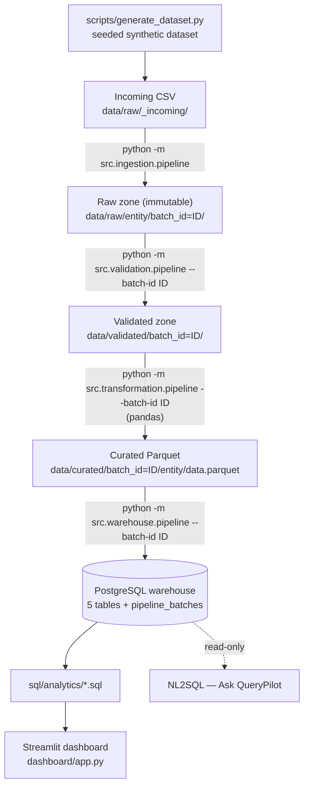

### V2 — Airflow + PySpark

The same logical pipeline, orchestrated by one Airflow DAG, with the
transformation-heavy step performed by PySpark. **Airflow = orchestration. PySpark =
transformation. Local filesystem = storage. PostgreSQL = warehouse.**

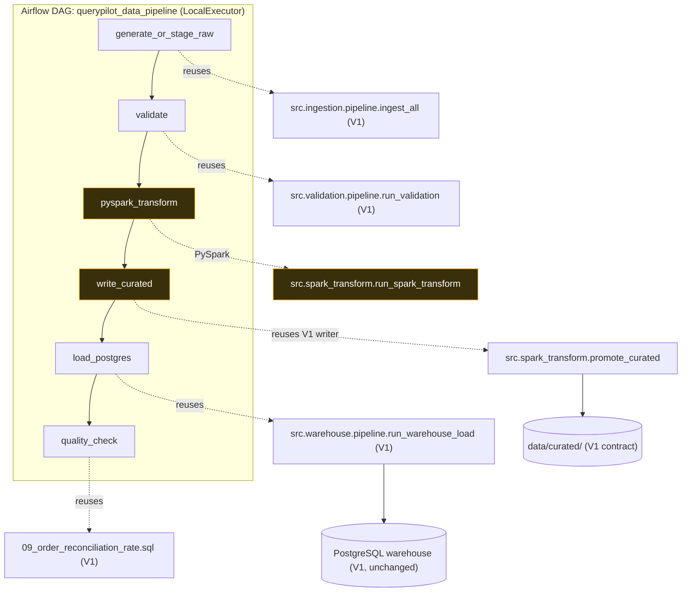

V2 changes exactly one engine (transformation: pandas → Spark) and adds one driver
(Airflow). Ingestion, validation, the curated-data contract, the warehouse loader,
the warehouse schema, the quality checks, the dashboard, and NL2SQL are all reused
**unchanged**.

---

## Overall Architecture

Raw data flows one direction. The dashboard and NL2SQL are read-only consumers of
the warehouse. **The V1 path and the V2 path converge at the curated-data contract
and again at the warehouse** — everything downstream is identical.

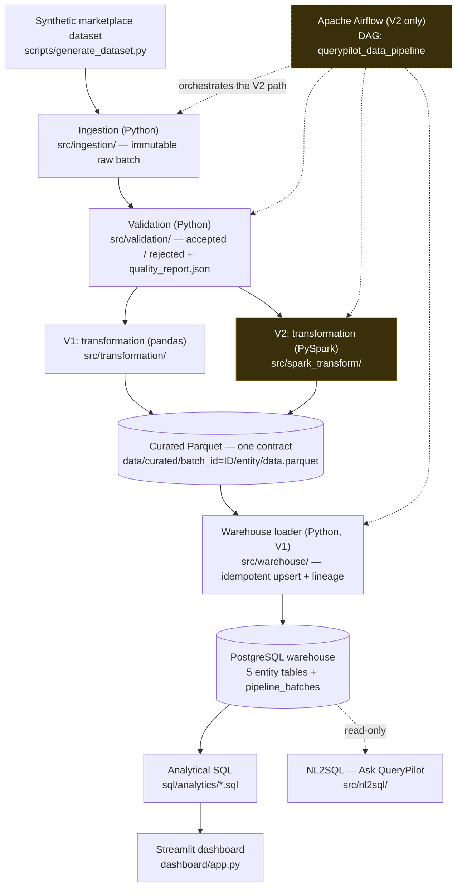

- **V1 path:** run the four `python -m src.<stage>.pipeline` commands directly. No
  Airflow, no Spark, no Docker.
- **V2 path:** trigger the Airflow DAG; `pyspark_transform` replaces the pandas
  transformation; everything else is the same code.

---

## Airflow Architecture

Airflow is the **workflow orchestrator** for V2 — it schedules, sequences, retries,
and surfaces the status of the pipeline steps. It does **not** perform the
transformation itself (PySpark does) and it does **not** replace any V1 logic; every
task is a thin call into code that already exists in `src/` and is already tested.

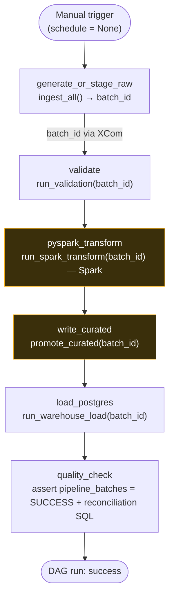

**Actual DAG configuration** (`orchestration/dags/querypilot_data_pipeline.py`):

| Setting | Value |
|---|---|
| `dag_id` | `querypilot_data_pipeline` |
| API | TaskFlow API (`@dag` / `@task`) |
| `schedule` | `None` (manual trigger only) |
| `catchup` | `False` |
| `max_active_runs` | `1` |
| `default_args` | `retries=1`, `retry_delay=1 minute` |
| `start_date` | `2026-01-01` (UTC) |
| `tags` | `querypilot`, `v2`, `pyspark` |
| Executor | `LocalExecutor` |
| `batch_id` propagation | returned by `generate_or_stage_raw`, passed as each task's argument via XCom |

Task → code mapping (nothing reimplemented):

| Task | Calls |
|---|---|
| `generate_or_stage_raw` | `src.ingestion.pipeline.ingest_all()` — V1 |
| `validate` | `src.validation.pipeline.run_validation()` — V1 |
| `pyspark_transform` | `src.spark_transform.pipeline.run_spark_transform()` — **PySpark** |
| `write_curated` | `src.spark_transform.pipeline.promote_curated()` — writes via V1's writer/report |
| `load_postgres` | `src.warehouse.pipeline.run_warehouse_load()` — V1, unchanged |
| `quality_check` | asserts `pipeline_batches.status = SUCCESS`; runs `sql/analytics/09_order_reconciliation_rate.sql` — V1 |

---

## PySpark Architecture

PySpark exists in V2 to perform the **transformation-heavy step** — the part with
joins across all five entities, cross-entity filtering, and a group-by aggregation —
using an explicit-schema DataFrame engine rather than pandas. It is a genuine Spark
job, not an import-Spark-then-go-to-pandas shim.

Spark runs **locally** (`local[*]` master, one process). This is not a cluster and
makes no distributed-scale claims — the dataset is a few thousand rows. The value
here is the engineering pattern: declared schemas, relational joins, and
partition-aware processing.

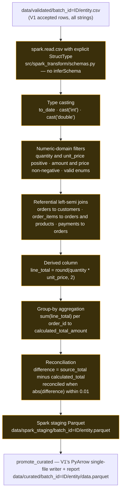

### The Spark job, precisely

`src/spark_transform/transform.py` (`transform_batch`) does, in order:

1. **Explicit `StructType` schemas** per entity — every column declared, `inferSchema`
   never used.
2. **CSV reads** of the V1 validated output.
3. **Type casting** — `F.to_date(...)`, `cast("int")`, `cast("double")`.
4. **Numeric-domain filters** — `quantity > 0`, `unit_price > 0`, `amount >= 0`,
   `price >= 0`, valid status / method / payment-status enums.
5. **Referential `left_semi` joins** — orders filtered to surviving customers; then
   `order_items` filtered to surviving orders **and** surviving products; then
   payments filtered to surviving orders. The curated set is internally consistent
   by construction.
6. **Derived column** — `order_items.line_total = round(quantity * unit_price, 2)`.
7. **Group-by aggregation** — `groupBy("order_id").agg(round(sum("line_total"), 2))`,
   joined back onto orders to produce `calculated_total_amount`,
   `total_amount_difference`, and the boolean `total_amount_reconciled`
   (tolerance `0.01`, identical to V1's `src/transformation/business.py`).

### Why the final write is not a pure Spark sink

V1's curated contract is **one `data.parquet` file per entity** — not a Spark
part-file directory. So `pyspark_transform` writes each transformed DataFrame to a
neutral **staging** Parquet (`data/spark_staging/`), and a separate step,
`write_curated` (`promote_curated`), reads that staging Parquet with pandas and
writes the canonical single-file layout **using V1's own
`src/transformation/writer.py` and `src/transformation/report.py`** (PyArrow).

This is deliberate and stated plainly: **the final single-file promotion uses the
existing V1-compatible writer / PyArrow path after the Spark transformation.** It is
not a distributed Spark sink. It exists so the warehouse loader and dashboard need
zero changes — and, verified, a V2 curated batch is value-identical to V1's for the
same input.

---

## Data Quality

Data quality is enforced at three points and surfaced in the dashboard's **Data
Quality** tab. V2 uses the **same** validation and warehouse checks as V1.

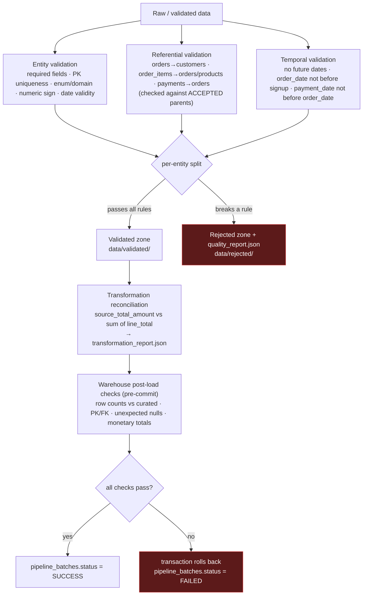

Actual mechanisms:

- **Validation rules** (`src/validation/rules.py`) — entity, referential, temporal.
- **Accepted vs rejected records** — written to separate zones; every rejected row
  keeps its full data plus every rule code it violated.
- **`quality_report.json`** per batch — total / valid / rejected rows, pass rate,
  rejection-reason counts.
- **Order-total reconciliation** — transformation compares the recorded order total
  to the sum of its (accepted) line items; the gap and a boolean flag are written to
  the curated `orders` table and to `transformation_report.json`. Mismatches arise
  naturally when validation quarantines some of an order's line items.
- **Warehouse post-load checks** (`src/warehouse/quality.py`) — run inside the load
  transaction, before commit: row counts against curated, primary-key uniqueness, no
  orphan foreign keys, no unexpected nulls, monetary-total agreement.
- **`pipeline_batches` status** — `IN_PROGRESS` → `SUCCESS` in the same transaction;
  `FAILED` written separately after a rollback. Only `SUCCESS` or `FAILED` ever
  persist.

---

## Storage and Warehouse

### Local filesystem zones

| Path | Contents |
|---|---|
| `data/raw/_incoming/` | committed source CSVs (so the repo runs without regenerating) |
| `data/raw/<entity>/batch_id=<id>/` | immutable landed raw copy + `data/raw/_batches/<id>.json` manifest |
| `data/validated/batch_id=<id>/` | accepted rows |
| `data/rejected/batch_id=<id>/` | rejected rows + `quality_report.json` |
| `data/curated/batch_id=<id>/<entity>/data.parquet` | typed, business-transformed Parquet + `transformation_report.json` |
| `data/spark_staging/batch_id=<id>/` | **V2 only** — Spark → pandas hand-off (gitignored) |
| `data/warehouse/batch_id=<id>/load_report.json` | warehouse load report |

**No S3. No MinIO. No cloud object storage.** This is a deliberate design choice:
the project is intentionally zero-cost and fully runnable on one machine. Everything
under `data/` (except the committed `_incoming/` CSVs) is pipeline output and is
gitignored.

### PostgreSQL warehouse

The warehouse is a single PostgreSQL database (developed against PostgreSQL 17). The
loader applies `sql/ddl/*.sql` idempotently on every run — there is no manual DDL
step. **V2 reuses the V1 warehouse loader and schema unchanged.**

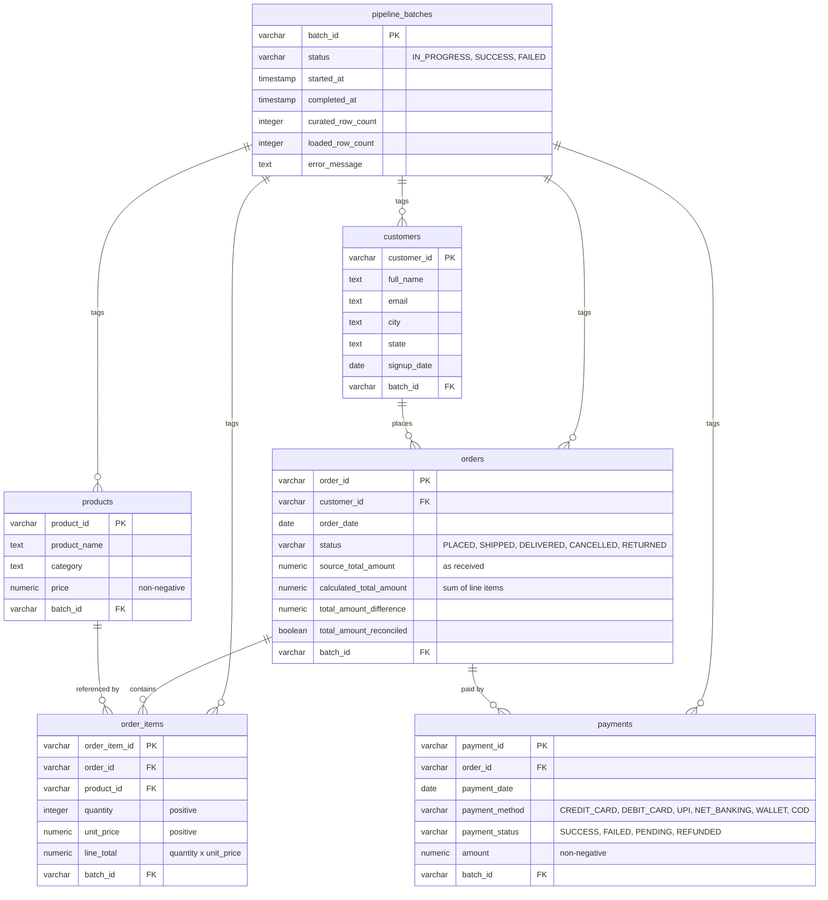

- Entity tables are **current-state (SCD Type 1)** — they reflect the latest
  successful load. `pipeline_batches` is an **append-only** ledger of every load
  attempt.
- Every entity row carries a `batch_id` foreign key into `pipeline_batches`.
- Indexes exist on the foreign-key join columns and the two analytics date columns
  (`sql/ddl/007_indexes.sql`).

---

## Pipeline Batch Lifecycle

One `batch_id` is minted per run and travels through every stage. In V2 it is
returned by the first task and passed to each subsequent task via XCom.

```mermaid
flowchart LR
    B1["batch_id generated<br/>(ingestion / generate_or_stage_raw)"] --> B2["raw<br/>data/raw/entity/batch_id=ID/"]
    B2 --> B3["validated<br/>data/validated/batch_id=ID/"]
    B3 --> B4["Spark transformed<br/>data/spark_staging/batch_id=ID/"]
    B4 --> B5["curated<br/>data/curated/batch_id=ID/"]
    B5 --> B6["warehouse loaded<br/>upsert, one transaction"]
    B6 --> B7["quality checked<br/>post-load checks + reconciliation SQL"]
    B7 --> B8(["pipeline_batches.status = SUCCESS"])
```

- The V1 path skips `data/spark_staging/` — its pandas transformation writes
  `data/curated/` directly.
- Re-running a `batch_id` that already succeeded is refused at every stage; a failed
  warehouse load rolls back fully and records `FAILED` for retry.

---

## Analytics Dashboard

A read-only Streamlit presentation layer over the warehouse. It never writes to
PostgreSQL and never re-runs a pipeline stage. **V2 requires no dashboard changes**
— the curated-data contract and warehouse schema are unchanged, so the analytics
layer stays compatible.

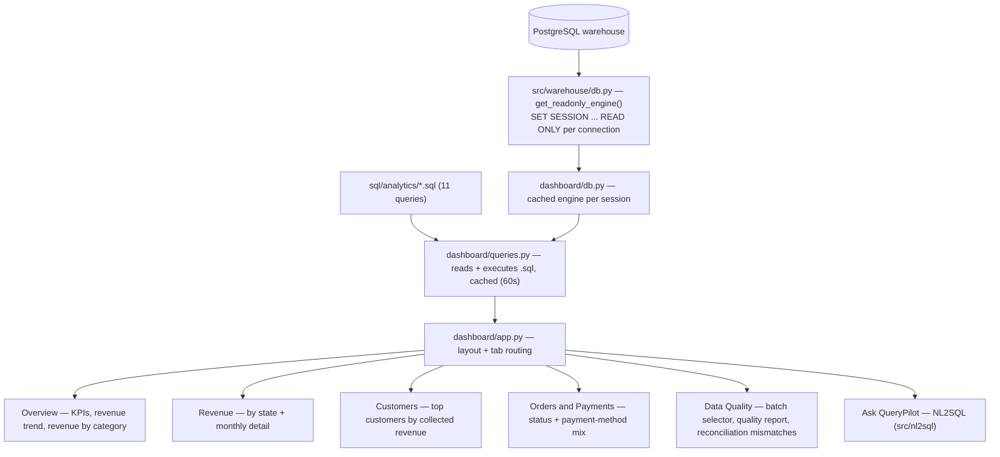

The **Data Quality** tab reads a batch's `quality_report.json` straight from disk
and joins it with reconciliation figures from SQL. Every other figure reflects
current warehouse state.

### NL2SQL — "Ask QueryPilot"

A plain-English question becomes a real result set through a fixed pipeline where
**the LLM is never the security boundary** — it only proposes a SQL string:

```
question → length guard → per-session throttle → schema discovery → LLM SQL
        → static AST validation (sqlglot) → [only if valid] read-only execution
```

If validation fails, `execute_sql()` is not called at all. Execution runs over a
connection that is itself read-only (`SET SESSION CHARACTERISTICS AS TRANSACTION
READ ONLY`), with a server-side statement timeout and a client-side row cap.

---

## Pipeline Entry Points

### V1 — plain Python (no Airflow, no Spark, no Docker)

```bash
python scripts/generate_dataset.py                        # optional; _incoming/ is committed
python -m src.ingestion.pipeline                          # prints the new BATCH_ID
python -m src.validation.pipeline      --batch-id <BATCH_ID>
python -m src.transformation.pipeline  --batch-id <BATCH_ID>
python -m src.warehouse.pipeline       --batch-id <BATCH_ID>
streamlit run dashboard/app.py
```

### V2 — Airflow DAG

Trigger `querypilot_data_pipeline` from the Airflow UI or CLI (see
[Local Setup](#local-setup)). One trigger runs all six tasks.

### V2 — Spark transform without Airflow

For development / CI, the V2 transformation runs standalone against an existing
validated batch:

```bash
pip install -r requirements-dev.txt                       # adds pyspark; needs a local JDK 17+
python -m src.spark_transform.pipeline --batch-id <BATCH_ID>              # stage + promote
python -m src.spark_transform.pipeline --batch-id <BATCH_ID> --stage-only
python -m src.spark_transform.pipeline --batch-id <BATCH_ID> --promote-only
```

V1 users are never required to run through Airflow or Spark.

---

## Docker / Local Airflow

The V2 stack is defined by four files:

| File | Role |
|---|---|
| `docker-compose.airflow.yml` | the local Airflow stack |
| `orchestration/Dockerfile` | `apache/airflow:2.10.3-python3.11` + OpenJDK 17 + `pyspark==3.5.3` + a subset of project deps |
| `orchestration/requirements-airflow.txt` | pyspark, pandas, pyarrow, python-dotenv (Airflow itself comes from the base image) |
| `orchestration/.env.airflow.example` | template for the warehouse connection (copy to `orchestration/.env.airflow`, which is gitignored) |

Services:

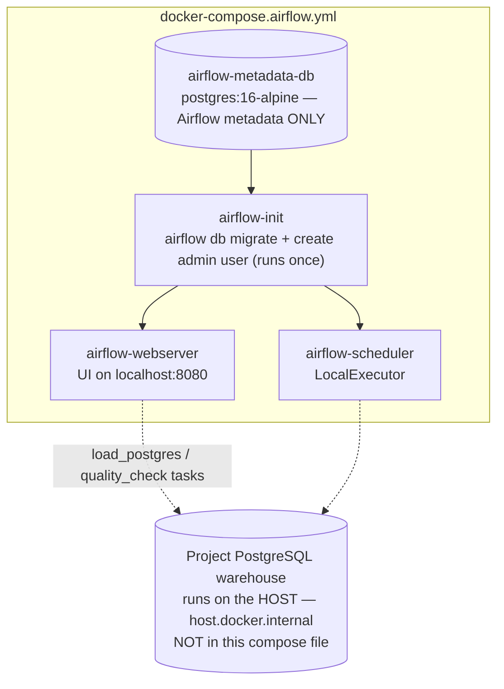

- **Executor:** `LocalExecutor`. Single-node local orchestration — no Celery, no
  workers, no Redis.
- **`airflow-metadata-db`** is a dedicated `postgres:16-alpine` container used
  **only** for Airflow's own metadata (DAG runs, task instances, XCom). It is **not**
  the project warehouse and contains no warehouse data.
- **The project warehouse** stays on the host and is reached from the containers at
  `host.docker.internal:5432`. It is not part of this compose file.
- **UI:** `http://localhost:8080` — the `airflow-webserver` service publishes port
  `8080`.

Shut the stack down with:

```bash
docker compose -f docker-compose.airflow.yml down
```

(Plain `down` removes the containers and network and keeps the Airflow metadata
volume. It does not touch the host warehouse.)

---

## Configuration

Two separate environments; do not mix them.

### V1 — Python environment (`.env`, gitignored)

| Variable | Purpose |
|---|---|
| `POSTGRES_HOST` / `POSTGRES_PORT` / `POSTGRES_DB` / `POSTGRES_USER` / `POSTGRES_PASSWORD` | warehouse connection |
| `NL2SQL_PROVIDER` | `anthropic` / `gemini` / `ollama` / `openrouter` (optional; default `anthropic`) |
| provider keys (`GEMINI_API_KEY`, …) | only the selected provider's key is read |

See `.env.example`. Credentials belong only in `.env` — never in `.env.example`,
never committed.

### V2 — Airflow Docker environment (`orchestration/.env.airflow`, gitignored)

Copy `orchestration/.env.airflow.example` to `orchestration/.env.airflow` and set
the warehouse `POSTGRES_*` values (host stays `host.docker.internal`). **Do not
commit `orchestration/.env.airflow`** — it is gitignored, and it is local to your
machine. The Airflow metadata DB credentials are internal to the compose file and
need nothing configured here.

---

## Local Setup

### V1

```bash
python -m venv .venv
.venv\Scripts\activate                 # Windows  (source .venv/bin/activate on POSIX)
pip install -r requirements.txt
copy .env.example .env                  # fill in a reachable PostgreSQL

# create the warehouse database once:
#   CREATE DATABASE dataeng_warehouse;

python -m src.ingestion.pipeline
python -m src.validation.pipeline      --batch-id <BATCH_ID>
python -m src.transformation.pipeline  --batch-id <BATCH_ID>
python -m src.warehouse.pipeline       --batch-id <BATCH_ID>
streamlit run dashboard/app.py
```

V1 requires **no** Airflow, PySpark, or Docker.

### V2

```bash
# 1. Start Docker Desktop (or Docker Engine).

# 2. Prepare the local Airflow environment:
cp orchestration/.env.airflow.example orchestration/.env.airflow
#    → set POSTGRES_PASSWORD (and POSTGRES_USER if not "postgres")

# 3. Build and start the Airflow stack (first build takes a few minutes):
docker compose -f docker-compose.airflow.yml up -d --build

# 4. Open the Airflow UI:
#    http://localhost:8080   (admin / admin)

# 5. Find the DAG:  querypilot_data_pipeline
# 6. Un-pause it.
# 7. Trigger one DAG run.
# 8. Watch the six tasks:
#    generate_or_stage_raw → validate → pyspark_transform → write_curated → load_postgres → quality_check

# Shut down when done:
docker compose -f docker-compose.airflow.yml down
```

Curated Parquet and the warehouse load land on the host filesystem (the repo is
bind-mounted into the containers), so the existing dashboard reads V2 output with no
changes.

---

## Testing

```bash
python -m pytest -q
```

**Verified result (with `requirements-dev.txt` installed): `243 passed, 1 skipped`.**

| Group | Count | Notes |
|---|---|---|
| V1 pipeline + dashboard + NL2SQL tests | 236 | unit + real-database integration; DB tests use throwaway databases and **skip cleanly** if no PostgreSQL is reachable |
| V2 PySpark transformation tests (`tests/test_spark_transform.py`) | 7 | run only when `pyspark` + a local JDK are present (i.e. `requirements-dev.txt` installed); **skip cleanly** otherwise |
| V2 Airflow DAG test (`tests/test_airflow_dag.py`) | 1 skipped | needs `apache-airflow`, which is **not** installed in the V1 environment — it runs inside the Airflow image |

With only `requirements.txt` installed, the 7 PySpark tests skip instead of running
(the DAG test skips in both cases). Unit / functional tests run in the plain Python
environment; the **live Airflow + PySpark run** (next section) is a separate, manual
verification.

---

## Live Verification

A full live smoke test of the V2 stack was run and confirmed:

| Check | Result |
|---|---|
| Docker Engine | 29.7.2, Linux (WSL2), 8 CPU |
| Airflow image build | succeeded (`apache/airflow:2.10.3-python3.11` + OpenJDK 17.0.20.1 + pyspark 3.5.3) |
| `airflow-metadata-db` | healthy |
| `airflow-scheduler` | running (LocalExecutor) |
| `airflow-webserver` | healthy — `http://localhost:8080/health` → HTTP 200 |
| DAG import | `querypilot_data_pipeline` listed, **zero import errors** |
| DAG runs triggered | exactly **one** |
| Task results | `generate_or_stage_raw` ✅ · `validate` ✅ · `pyspark_transform` ✅ · `write_curated` ✅ · `load_postgres` ✅ · `quality_check` ✅ — **all 6 SUCCESS** (~44 s total) |
| PySpark actually executed | Spark JVM started (`NativeCodeLoader` WARN in scheduler logs during the task window); a ~6 s SparkSession startup gap in the task log; image has JDK 17 + pyspark 3.5.3 |
| Spark operations executed | explicit-schema CSV reads, casts, referential `left_semi` joins, numeric-domain filters, `line_total`, group-by reconciliation aggregation |
| Curated Parquet | generated in the V1 single-file layout for all 5 entities (customers 484 / products 95 / orders 1845 / order_items 4160 / payments 1934) |
| `transformation_report.json` | contains `"engine": "pyspark"` |
| V2 output vs V1 output | **value-identical** for all 5 entities (same seeded input) |
| PostgreSQL load | via the **unchanged** `run_warehouse_load`; 8518 rows upserted; post-load checks passed |
| Warehouse batch status | `pipeline_batches.status = SUCCESS`, `loaded_row_count = 8518`, no error |
| `quality_check` | passed — reconciliation rate 79.02% (1458 / 1845 orders) |
| V1 standalone | `python -m src.ingestion.pipeline` still runs with no Airflow / Spark / Docker |
| Full test suite | `243 passed, 1 skipped` |

No runtime logs are reproduced here as screenshots; the table above is the recorded
outcome.

---

## V1 / V2 Compatibility

The two paths share everything except one engine and one driver.

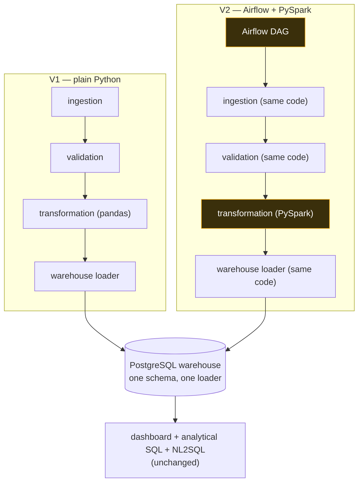

| Concern | State |
|---|---|
| `requirements.txt` | the V1 dependency baseline — **unchanged by V2** |
| PySpark | in `requirements-dev.txt` only (and in the Airflow Docker image) |
| Apache Airflow | Docker image only — never in any Python requirements file |
| V1 source code | does **not** import `airflow` or `pyspark` (verified) |
| V1 runnability | fully independent — no Airflow, Spark, or Docker required |
| Curated-data contract | identical (one `data.parquet` per entity per batch) |
| Warehouse schema + loader | reused unchanged |
| Data-quality checks | reused unchanged |

---

## Design Decisions

1. **Preserve V1.** It is the stable baseline and is not rewritten.
2. **Add V2, don't replace V1.** V2 is a second driver and a second transformation
   engine over the same logic.
3. **Airflow for orchestration.** Sequencing, retries, XCom `batch_id` propagation,
   and run visibility — not transformation.
4. **PySpark for the transformation-heavy step.** Explicit schemas, relational
   joins across five entities, cross-entity filtering, a group-by aggregation.
5. **Local filesystem storage.** Keeps the project zero-cost and runnable anywhere;
   no S3 / MinIO / cloud object storage.
6. **PostgreSQL stays the warehouse.** Same schema, same loader, same lineage
   ledger.
7. **Preserve the curated-data contract.** V2 promotes Spark output to V1's exact
   single-file Parquet layout via V1's own writer.
8. **V2 output must match V1 output.** Verified value-identical for all five
   entities on the same input.
9. **No unnecessary cloud infrastructure.**
10. **No distributed infrastructure this dataset doesn't need** — Spark runs
    `local[*]`; Airflow runs `LocalExecutor`.

---

## Current Limitations

- **Spark runs locally** (`local[*]`, one process). This is not a production Spark
  cluster and makes no distributed-scale or throughput claims.
- **Airflow uses `LocalExecutor`** — single-node local orchestration.
- **DAG scheduling is manual** (`schedule=None`); there is no cron schedule or
  backfill.
- **No object storage.** Raw/validated/curated data lives on the local filesystem
  by design.
- **The final single-file Parquet promotion uses V1's PyArrow writer**, not a Spark
  sink — a deliberate choice to preserve the V1 curated contract.
- **On a Windows host, local Spark carries JVM startup and per-action overhead** and
  needs a JDK 17+; the standalone Spark test module takes a couple of minutes there
  (fast inside the Linux container).
- **Warehouse entity tables are current-state (SCD Type 1)** — no per-batch
  historical snapshot.
- **The dataset is synthetic and static** — recent-looking timestamps come from
  fixed constants, not a live feed.

None of these are defects; they are the scope boundaries of a deliberately
local-first project.

---

## Future Roadmap

**Everything below is NOT IMPLEMENTED** — direction only.

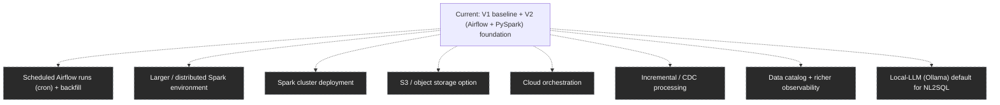

Guiding constraints, unchanged: zero mandatory cloud fees, no paid managed
services, no object storage in the default path, everything runnable locally, and
existing business logic reused rather than rewritten.

---

## Technology Stack

| Concern | Choice | Notes |
|---|---|---|
| Language | Python | 3.9+ (host); the Airflow image uses Python 3.11 |
| V1 tabular processing | pandas | |
| V2 transformation engine | PySpark | `3.5.3`, `local[*]`, JDK 17+ |
| Columnar storage | Parquet via PyArrow | curated zone; also the V2 staging + single-file promotion |
| Warehouse | PostgreSQL | developed against PostgreSQL 17 |
| DB access | SQLAlchemy + psycopg2 | `create_engine(..., future=True)` |
| V2 orchestration | Apache Airflow | `2.10.3`, `LocalExecutor`, TaskFlow API |
| V2 local runtime | Docker + Docker Compose | Airflow webserver / scheduler / metadata DB |
| Analytical SQL | plain `.sql` files | `sql/analytics/` — single source of truth |
| Dashboard | Streamlit | Altair charts ship with Streamlit — no extra dependency |
| NL2SQL SQL safety | `sqlglot` | AST-based, PostgreSQL dialect |
| Structured LLM output | `pydantic` | |
| Testing | `pytest` | |
| Config | `python-dotenv` | `.env` (V1), `orchestration/.env.airflow` (V2) |

Not used: S3 / MinIO / cloud object storage, Kafka, RabbitMQ, `CeleryExecutor`,
Kubernetes, dbt, a Spark cluster, any managed service, any auth layer.

---

## Repository Structure

```
.
├── scripts/
│   └── generate_dataset.py       # seeded synthetic dataset generator (stdlib only)
├── src/
│   ├── ingestion/                # CSV → immutable raw batch + manifest
│   ├── validation/               # entity / referential / temporal rules; accepted + rejected
│   ├── transformation/           # V1: pandas transform → curated Parquet + report
│   ├── spark_transform/          # V2: the same transform in PySpark (session, schemas, transform, pipeline)
│   ├── warehouse/                # DDL apply, idempotent upsert, lineage ledger, post-load checks
│   ├── nl2sql/                    # schema discovery, LLM SQL generation, AST validation, read-only execution
│   │   └── providers/            # anthropic / gemini / ollama / openrouter
│   └── catalog/                   # reserved for dataset/schema metadata (currently empty)
├── dashboard/                     # read-only Streamlit app (app, queries, db, charts, format, components, nl2sql_ui)
├── sql/
│   ├── ddl/                      # warehouse table definitions (applied idempotently by the loader)
│   └── analytics/                # 11 read-only analytical queries (+ dashboard/ subset)
├── orchestration/                # V2: Airflow image + DAG (local Docker only)
│   ├── Dockerfile
│   ├── requirements-airflow.txt
│   ├── .env.airflow.example
│   └── dags/querypilot_data_pipeline.py
├── docker-compose.airflow.yml     # V2: local Airflow stack (LocalExecutor)
├── data/                          # pipeline zones (gitignored except raw/_incoming/)
├── tests/                         # 236 V1 tests + test_spark_transform.py + test_airflow_dag.py
├── config/settings.py             # environment-driven configuration
├── docs/v2-airflow-pyspark.md     # extended V2 notes
├── requirements.txt               # V1 runtime — unchanged by V2
└── requirements-dev.txt           # dev-only: pyspark for running the V2 path locally
```

Key directories: `src/` holds every pipeline stage as an independent package;
`src/spark_transform/` and `orchestration/` are the entire V2 surface; `sql/` is the
single source of truth for all SQL; `data/` is local pipeline output.

---

## Project Status

**V1** — stable Python data engineering pipeline: ingestion, validation,
transformation, curated Parquet, PostgreSQL warehouse, data-quality and
reconciliation checks, analytical SQL, Streamlit dashboard, NL2SQL.

**V2** — working additive enhancement: Apache Airflow orchestration + PySpark
transformation, local filesystem storage, the same PostgreSQL warehouse, reusing
V1's ingestion / validation / curated contract / warehouse loader / quality checks.

**Verification**

- `243` tests passing, `1` skipped.
- The real Airflow DAG `querypilot_data_pipeline` executed successfully — all 6
  tasks SUCCESS.
- PySpark transformation verified to run and to produce output value-identical to
  V1.
- PostgreSQL load verified through the unchanged V1 loader; `pipeline_batches`
  status SUCCESS.
- V1 standalone execution verified without Airflow, PySpark, or Docker.

**Branches**

- `main` — V1 baseline.
- `feature/airflow-pyspark-pipeline` — V2 enhancement. **Not merged into `main`.**
