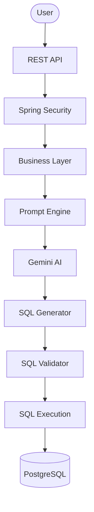
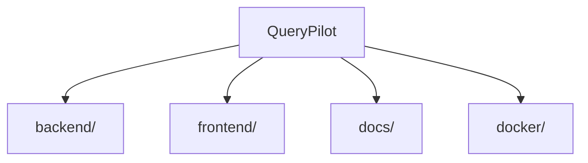

# QueryPilot

**Enterprise-grade AI-powered Natural Language to SQL platform.**


QueryPilot lets users query relational databases in plain English. It is built on a modern Spring Boot backend designed around enterprise conventions — layered architecture, centralized error handling, and a security-first foundation — with AI-driven SQL generation introduced incrementally on top of that base.

---

## Why QueryPilot?

- **Natural language to SQL** — describe the data you want, not the query syntax.
- **AI-assisted generation** — SQL is produced by an LLM-backed prompt engine, not hand-written templates.
- **Enterprise architecture** — a conventional, layered Spring Boot structure that scales with the team.
- **Secure by design** — authentication, authorization, and encryption are first-class concerns, not afterthoughts.
- **Extensible core** — infrastructure (responses, exceptions, security, constants) is built once and reused by every feature that follows.

---

## Features

### Implemented

| Area | Capability |
|---|---|
| ✔ | Java 21 |
| ✔ | Spring Boot 3 |
| ✔ | Enterprise package structure (`config`, `service`, `security`, `exception`, …) |
| ✔ | Spring Security foundation (stateless, CSRF-disabled filter chain) |
| ✔ | Global exception handling (`@RestControllerAdvice`) |
| ✔ | Generic API response envelope |
| ✔ | Jakarta Bean Validation support |
| ✔ | Shared utility layer |
| ✔ | Centralized application constants |

### Planned

| Area | Capability |
|---|---|
| ○ | Authentication |
| ○ | JWT-based session management |
| ○ | AES encryption for sensitive data |
| ○ | Database metadata discovery |
| ○ | Prompt engineering layer |
| ○ | Google Gemini integration |
| ○ | SQL validation |
| ○ | SQL execution engine |
| ○ | Query history |
| ○ | Dashboard |
| ○ | Docker packaging |
| ○ | Monitoring & observability |

---

## High-Level Architecture



The layers beyond Spring Security (prompt engine, AI integration, SQL generation/validation/execution) are part of the target architecture and are introduced incrementally — see [Features](#features) for current status.

---

## Repository Structure



| Folder | Purpose |
|---|---|
| [`backend/`](backend/README.md) | Spring Boot backend — application code, configuration, and tests |
| `frontend/` | Client application (not yet started) |
| `docs/` | Project documentation — HLD, LLD, API reference, roadmap (added incrementally) |
| `docker/` | Container and deployment configuration (not yet started) |

See [`backend/README.md`](backend/README.md) for the backend's internal package layout, configuration, and run instructions.

---

## Technology Stack

**Backend**

| Concern | Choice |
|---|---|
| Language | Java 21 |
| Framework | Spring Boot |
| Security | Spring Security |
| Persistence | Spring Data JPA |
| Build tool | Maven |
| Database | PostgreSQL |

**Planned**

| Concern | Choice |
|---|---|
| AI provider | Google Gemini |
| Containerization | Docker |
| Monitoring | Grafana |
| Metrics | Prometheus |

---

## Development Status

**Current version:** v1.2.0
**Status:** Actively under development.

The current implementation provides the enterprise backend foundation — project structure, security scaffolding, global error handling, and shared infrastructure. Advanced AI capabilities (prompt engine, SQL generation, execution) will be introduced incrementally on top of this base.

---

## Documentation

Project documentation lives in [`docs/`](docs/). Detailed material — High-Level Design, Low-Level Design, API reference, security model, deployment guide, and roadmap — will be added gradually as development progresses.

---

## Getting Started

```sh
# Clone the repository
git clone https://github.com/the-illuminatus/Spring_backend_based_NLP-AI.git
cd Spring_backend_based_NLP-AI/backend

# Build
mvn clean install

# Run
mvn spring-boot:run
```

For configuration, environment variables, and database setup, see [`backend/README.md`](backend/README.md).

---

## Contributing

Contributions are welcome. If you're interested in helping shape QueryPilot, please open an issue to discuss the change before submitting a pull request.

---

## License

Distributed under the MIT License.
