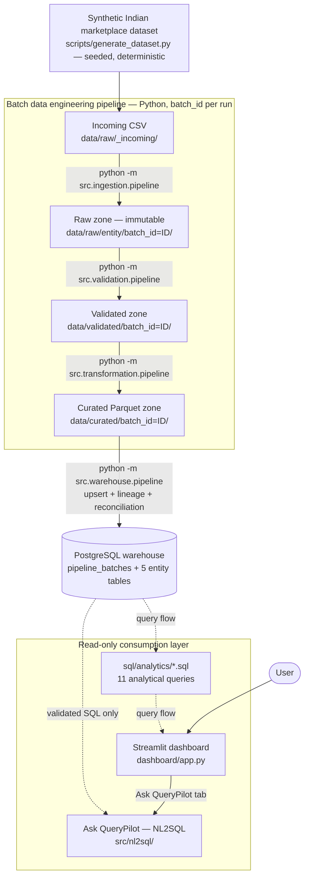
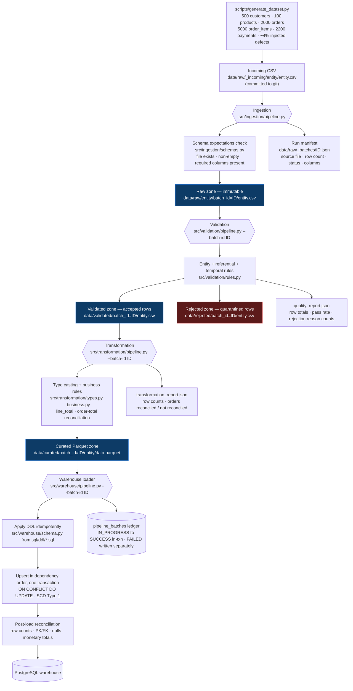
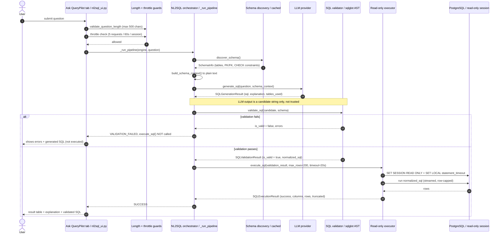
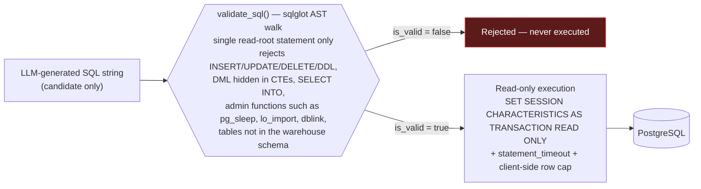
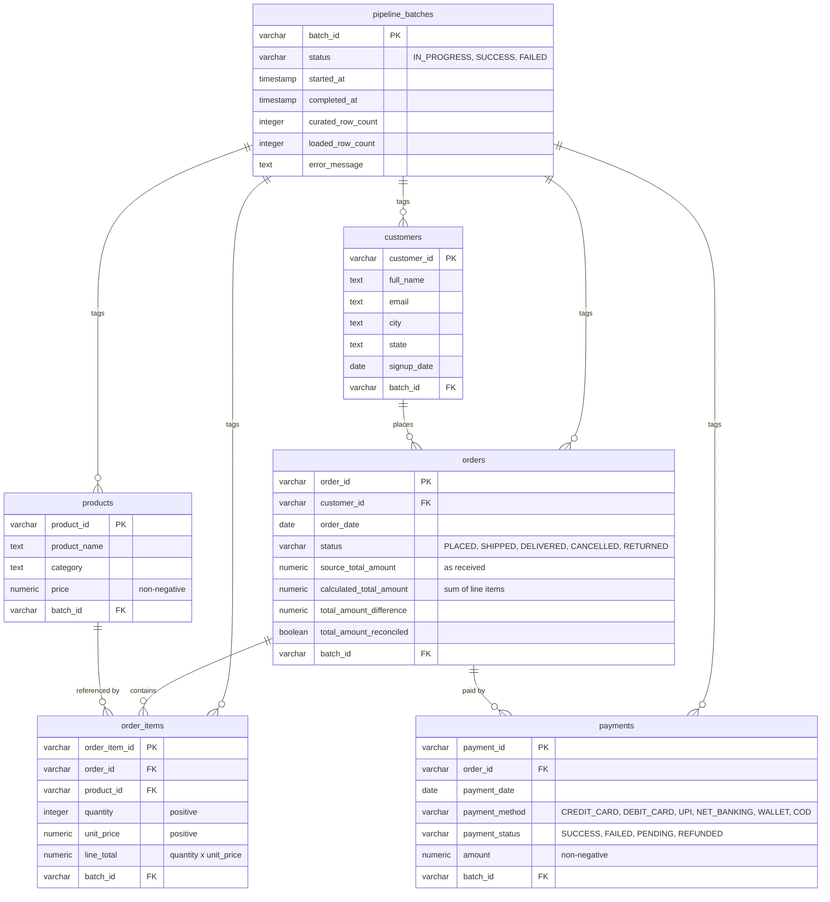
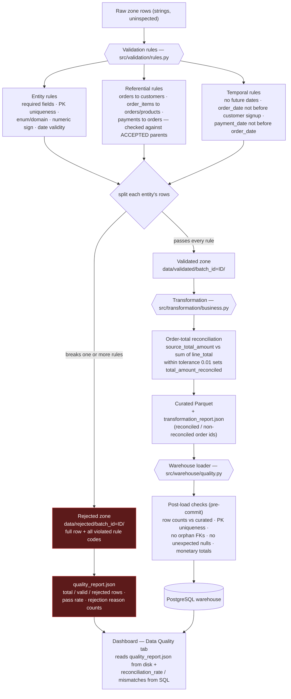
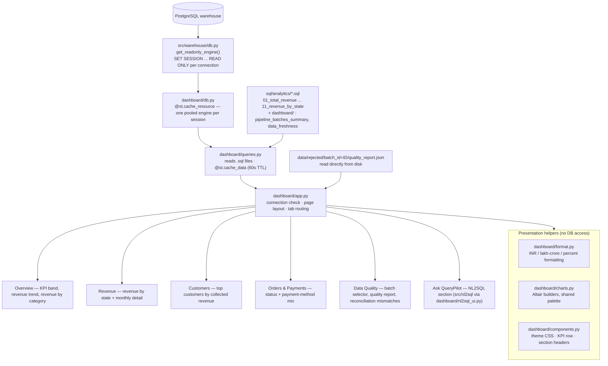
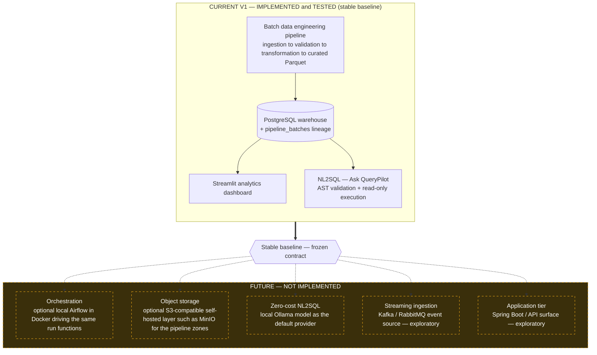

# QueryPilot

**A portfolio-grade data engineering platform for an India-focused digital-commerce
and payments analytics warehouse.**

QueryPilot generates a synthetic Indian marketplace dataset, runs it through an
explicit batch pipeline — ingestion, data-quality validation, transformation,
curated Parquet, PostgreSQL warehouse — and exposes it through a read-only
Streamlit analytics dashboard and a schema-aware, security-hardened
natural-language-to-SQL layer ("Ask QueryPilot").

Everything runs locally. There is no Spring Boot, no Angular, no auth service, and
no cloud dependency. The design goal is to demonstrate credible data-engineering
fundamentals end to end without introducing infrastructure the project does not
need.

- **Language / processing:** Python, pandas, PyArrow
- **Warehouse:** PostgreSQL (SQLAlchemy + psycopg2)
- **Dashboard:** Streamlit (Altair charts, bundled)
- **NL2SQL:** provider-agnostic LLM generation (Anthropic / Gemini / Ollama / OpenRouter) + `sqlglot` AST safety gate
- **Tests:** 236 passing `pytest` tests
- **Currency:** all monetary values are Indian rupees (INR), formatted with lakh/crore conventions

---

## Key Capabilities

| Area | What it does |
|---|---|
| **Synthetic dataset** | Deterministic, seeded generator (`scripts/generate_dataset.py`, standard library only) producing five related entities — customers, products, orders, order_items, payments — with Indian names/cities/states, an INR-priced catalogue, a UPI-led payment mix, and ~4% deliberately injected data-quality defects. |
| **Batch ingestion** | Structural (shape-only) validation, then immutable landing into a batch-partitioned raw zone with a per-run JSON manifest. One `batch_id` per run, shared across all entities. |
| **Data-quality validation** | Entity, referential (foreign-key), and temporal rules. Valid and rejected rows are written separately, plus a machine-readable `quality_report.json` per batch. Rejections are an expected outcome, not a pipeline failure. |
| **Transformation** | Type casting, `order_items.line_total`, and an orders-level reconciliation between the source total and the total implied by line items — the source value is never overwritten. Output is curated Parquet per batch. |
| **PostgreSQL warehouse** | Idempotent `INSERT ... ON CONFLICT DO UPDATE` loading in dependency order inside one transaction, an append-only `pipeline_batches` lineage ledger, and post-load reconciliation checks (row counts, PK/FK integrity, monetary totals) before commit. |
| **Analytics dashboard** | Read-only Streamlit product over the warehouse: KPIs, revenue/customer/order/payment analytics, pipeline health, and reconciliation drill-down. DB-session-level read-only enforcement. |
| **NL2SQL — "Ask QueryPilot"** | Plain-English question → schema-grounded LLM SQL → **static AST validation** → **bounded read-only execution**. The LLM only ever proposes a string; it is never the security boundary. |

---

## Architecture

All diagrams below describe the **current, implemented V1 architecture**. Anything
future is confined to the [Future Roadmap](#future-roadmap) section and explicitly
labelled.

Consistent terminology used throughout:

| Term | Meaning |
|---|---|
| **Incoming CSV** | `data/raw/_incoming/<entity>/<entity>.csv` — committed source-system extracts |
| **Raw zone** | `data/raw/<entity>/batch_id=<id>/` — immutable landed copy |
| **Validated zone** | `data/validated/batch_id=<id>/` — accepted rows |
| **Rejected zone** | `data/rejected/batch_id=<id>/` — rejected rows + `quality_report.json` |
| **Curated zone** | `data/curated/batch_id=<id>/<entity>/data.parquet` — typed, business-transformed Parquet |
| **Warehouse** | PostgreSQL: `pipeline_batches` + `customers` / `products` / `orders` / `order_items` / `payments` |

### Overall Architecture

The batch pipeline is a one-directional data flow (solid arrows). The dashboard and
NL2SQL are read-only consumers of the warehouse (dashed arrows = query flow). Both
consumers ultimately read the same PostgreSQL warehouse and nothing upstream of it.



### Data Engineering Pipeline

Four independent command-line stages, each reading the previous stage's zone and
writing the next. Every writer refuses to overwrite an existing batch, so re-running
is always safe and produces a new, independent batch. Sidecar JSON reports are
written at every stage; the `pipeline_batches` table in PostgreSQL is the permanent
load ledger.



Zone roles at a glance:

- **Raw** — bytes as received, only structurally checked, never value-inspected, never mutated.
- **Validated** — every row here passed all data-quality rules; downstream stages consume this and never re-run validation.
- **Curated** — typed columns, `line_total`, and reconciliation columns; the analytical hand-off shape.
- **Warehouse** — current-state (SCD Type 1) entity tables plus the append-only batch ledger.

### NL2SQL Architecture & Security

"Ask QueryPilot" turns a plain-English question into a real result set. Its
strongest engineering property is that **the LLM never provides the security
boundary** — it only produces a candidate string. Two independent gates stand
between that string and the database: a static AST validator (`sqlglot`) and a
DB-session-level read-only connection. SQL that fails validation is **never sent to
PostgreSQL** — `execute_sql()` is not called at all in that branch.



The non-negotiable ordering:



Defence in depth, deliberately layered:

1. **Length guard** — question over 500 chars rejected before any provider call.
2. **Per-session throttle** — 5 generation requests / 60s, tracked in Streamlit session state (`dashboard/nl2sql_ui.py`).
3. **Structured generation** — every provider must return `{ sql, explanation, tables_used }`; the shared system prompt asks for read-only SQL, but a prompt is not enforcement.
4. **Static AST validation** (`src/nl2sql/validation.py`) — parses with `sqlglot`, accepts only a single `SELECT` / `UNION` / `EXCEPT` / `INTERSECT` root, walks the whole tree for disallowed nodes and functions, and (when given the schema) rejects hallucinated tables.
5. **Type-level trust boundary** — `execute_sql()` accepts only a `SQLValidationResult` with `is_valid=True`, never a raw string.
6. **DB-session read-only enforcement** (`src/warehouse/db.get_readonly_engine`) — every connection runs `SET SESSION CHARACTERISTICS AS TRANSACTION READ ONLY`; the same guarantee the dashboard itself uses.
7. **Bounded execution** — server-side `statement_timeout` and client-side row cap (`fetchmany`, not a spliced `LIMIT`).

---

## Data Model

The warehouse schema is defined in `sql/ddl/*.sql` and applied idempotently by the
loader on every run. Every entity table carries a `batch_id` foreign key into
`pipeline_batches` — that column always reflects the batch that most recently
produced the row's current state, while `pipeline_batches` retains the full history
of every load attempt.



Notes:

- The incoming `orders.csv` has a single `total_amount` column. Transformation renames it to `source_total_amount` and adds the three reconciliation columns — the original value is preserved, never overwritten.
- Indexes exist on the foreign-key join columns and the two analytics date columns (`sql/ddl/007_indexes.sql`), not speculatively on every column.
- `customers` has no `country` column — this dataset is India-only, so the geographic dimension is `state`.

---

## Data Quality

Data quality is handled at two distinct points, and surfaced in the dashboard's
**Data Quality** tab.



**On injected defects and reconciliation:** the generator (`scripts/generate_dataset.py`)
first builds a fully consistent dataset where every order total already equals the
sum of its line items, then corrupts ~4% of rows per entity with **one** documented
defect each — missing required fields, duplicate primary keys, invalid foreign
keys, invalid enum values, non-positive quantities/prices, negative totals,
malformed/future dates, duplicate emails. Each defect maps to a specific validation
rule.

There is **no dedicated "unbalance the order total" defect**. Reconciliation
mismatches emerge as a *consequence*: when validation quarantines some of an
order's `order_items` rows, the surviving accepted line items no longer sum to that
order's recorded `total_amount`, and transformation records the gap via
`total_amount_difference` / `total_amount_reconciled`. The dashboard shows the
resulting reconciliation rate and lists the largest mismatches.

---

## Analytics Dashboard

`streamlit run dashboard/app.py`. A read-only presentation layer — it never writes
to PostgreSQL and never re-runs a pipeline stage. SQL text lives only in
`sql/analytics/*.sql`; the dashboard reads and executes those files rather than
re-typing queries as Python strings.



**Batch-selector limitation, stated plainly:** the warehouse entity tables are
current-state (Type 1) — they always reflect the *latest* successful load. The
**Data Quality** tab's batch selector only changes the pipeline-health panel (that
one load's row counts, status, and quality report). Every other figure on every
tab always reflects current warehouse state, regardless of which batch is selected.
The dashboard says this directly rather than implying historical snapshots it does
not provide.

---

## Technology Stack

| Concern | Choice | Notes |
|---|---|---|
| Language | Python 3.9+ | |
| Tabular processing | pandas | |
| Columnar storage | Parquet via PyArrow | curated zone only |
| Warehouse | PostgreSQL | developed against PostgreSQL 17 |
| DB access | SQLAlchemy 2.x + psycopg2 | |
| Configuration | environment variables via `python-dotenv` | `.env`, gitignored |
| Dashboard | Streamlit | Altair charts ship with Streamlit — no added dependency |
| NL2SQL generation | Anthropic / Gemini / Ollama / OpenRouter | selected by `NL2SQL_PROVIDER`; Gemini free-tier and Ollama are the no-cost options |
| NL2SQL safety gate | `sqlglot` | AST-based, PostgreSQL dialect |
| Structured LLM output | `pydantic` | enforces `{ sql, explanation, tables_used }` |
| Testing | `pytest` | 236 tests; warehouse/dashboard integration tests use throwaway databases and skip cleanly if none is reachable |

Deliberately **not** used: Airflow, Kafka, Spark, dbt, Kubernetes, DuckDB, any
cloud/managed service, any authentication layer. They are out of scope for this
project's size — see [Future Roadmap](#future-roadmap).

---

## Repository Structure

```
.
├── data/
│   ├── raw/
│   │   ├── _incoming/        # committed source extracts (5 CSVs)
│   │   ├── _batches/         # ingestion run manifests (gitignored)
│   │   └── <entity>/         # immutable batch-partitioned raw output (gitignored)
│   ├── validated/            # accepted rows per batch (gitignored)
│   ├── rejected/             # rejected rows + quality_report.json per batch (gitignored)
│   ├── curated/              # curated Parquet + transformation_report.json (gitignored)
│   └── warehouse/            # warehouse load report per batch (gitignored)
├── scripts/
│   └── generate_dataset.py   # synthetic dataset generator (stdlib only, seeded)
├── src/
│   ├── ingestion/            # shape-only checks, immutable batch landing, manifest
│   ├── validation/           # entity/referential/temporal rules, accepted + rejected output
│   ├── transformation/       # type casting, line_total, order reconciliation, curated Parquet
│   ├── warehouse/            # DDL application, upsert loading, lineage ledger, post-load checks
│   ├── catalog/              # reserved for dataset/schema metadata (currently empty)
│   └── nl2sql/               # discovery, context, generation, validation, execution
│       └── providers/        # anthropic / gemini / ollama / openrouter adapters
├── sql/
│   ├── ddl/                  # warehouse table definitions (applied idempotently by the loader)
│   └── analytics/            # 11 read-only analytical queries
│       └── dashboard/        # dashboard-only queries (batch history, data freshness)
├── dashboard/
│   ├── app.py                # Streamlit entrypoint / tabbed layout
│   ├── queries.py            # reads + executes sql/analytics/*.sql, cached
│   ├── db.py                 # cached, read-only-enforced PostgreSQL engine
│   ├── format.py             # INR / lakh-crore / number formatting (pure)
│   ├── charts.py             # Altair chart builders, shared palette
│   ├── components.py         # theme CSS, KPI cards, section headers
│   └── nl2sql_ui.py          # "Ask QueryPilot" section — orchestrates src/nl2sql only
├── tests/                    # 236 pytest tests (unit + real-database integration)
├── config/
│   └── settings.py           # environment-driven configuration
├── requirements.txt
├── requirements-dev.txt      # dev-only tooling (currently empty; generator is stdlib-only)
├── .env.example
└── .streamlit/config.toml    # dashboard theme
```

---

## Setup & Running

```bash
python -m venv .venv
.venv\Scripts\activate                 # Windows  (source .venv/bin/activate on POSIX)
pip install -r requirements.txt
copy .env.example .env                  # then fill in a reachable Postgres, and an NL2SQL provider if wanted
```

Create the warehouse database once, with whatever admin access you have:

```sql
CREATE DATABASE dataeng_warehouse;
```

Set `POSTGRES_HOST` / `POSTGRES_PORT` / `POSTGRES_DB` / `POSTGRES_USER` /
`POSTGRES_PASSWORD` in `.env`. The loader applies `sql/ddl/` itself on every run —
there is no manual DDL step.

Run the pipeline end to end:

```bash
python scripts/generate_dataset.py                              # optional — _incoming/ is already committed
python -m src.ingestion.pipeline                                # prints the new BATCH_ID
python -m src.validation.pipeline      --batch-id <BATCH_ID>
python -m src.transformation.pipeline  --batch-id <BATCH_ID>
python -m src.warehouse.pipeline       --batch-id <BATCH_ID>
streamlit run dashboard/app.py
```

The `<BATCH_ID>` is printed by ingestion and also recorded in `data/raw/_batches/`.

### NL2SQL provider

Set `NL2SQL_PROVIDER` in `.env` to one of `anthropic` / `gemini` / `ollama` /
`openrouter` (unset defaults to `anthropic` for backward compatibility). Only the
selected provider's own settings are read. Gemini's free tier and a local Ollama
model are the zero-cost options. Credentials belong only in `.env` — never in
`.env.example`, never committed.

---

## Testing

```bash
pytest
```

236 tests. Unit tests for every pipeline stage use isolated `tmp_path` fixtures and
monkeypatch the configured data directories — they never touch the real `data/`
tree. `tests/test_warehouse.py` and `tests/test_dashboard.py` each create and drop
a uniquely-named throwaway PostgreSQL database; if no server is reachable, or the
configured user cannot `CREATE DATABASE`, those modules **skip with an explanation**
rather than failing.

---

## Design Principles

- **Explicit stages, explicit hand-offs.** Each stage reads one zone and writes the
  next. No stage re-does an earlier stage's work — transformation trusts the
  validated zone; the warehouse loader trusts the curated zone.
- **Immutability and safe re-runs.** Every writer refuses to overwrite an existing
  batch. Warehouse loads are idempotent (`ON CONFLICT DO UPDATE`) and an
  already-succeeded batch is refused outright.
- **Bad data is an expected outcome, not a crash.** Data-quality rejections and
  reconciliation mismatches are measured and reported; the pipeline still exits 0.
  A *pipeline* failure (missing batch, corrupt file, already-processed batch) exits
  non-zero with a clear message.
- **Lineage is permanent.** `pipeline_batches` is append-only. Entity tables move
  forward to the newest batch's state; the ledger keeps every attempt.
- **Security boundaries are separate from the thing they guard.** The NL2SQL
  validator and read-only executor are independent of SQL generation — a provider
  (or a bug in one) can produce bad SQL; it cannot make bad SQL run.
- **One source of truth per concern.** SQL text lives in `sql/`. The read-only
  engine is built once in `src/warehouse/db.py` and reused by the dashboard and
  NL2SQL. Path construction is centralised per stage.
- **No dependency the project doesn't need.** Altair rather than a new chart
  library; `sqlglot` rather than a keyword blocklist; standard-library-only dataset
  generation.

---

## Current Limitations

- **Current-state warehouse only.** Entity tables are SCD Type 1 — no historical
  snapshot per batch. The dashboard is explicit about this.
- **Synthetic, static data.** Recent-looking timestamps come from fixed reference
  constants, not the wall clock. It is never presented as a live or real-time feed,
  and no external data source is called.
- **Manual orchestration.** The four stages are run by hand (or a shell script).
  There is no scheduler, no dependency graph engine, no retry/backfill machinery.
- **Local filesystem zones.** Raw/validated/curated data lives under `data/` on the
  local disk. There is no object-storage layer.
- **NL2SQL depends on an external LLM by default.** The zero-cost paths (Gemini
  free tier, local Ollama) exist but a fully offline default is not yet wired.
- **Single-node PostgreSQL.** No replication, partitioning, or columnar analytics
  engine — appropriate for the dataset size (thousands of rows).

---

## Future Roadmap

Everything below is **FUTURE / NOT IMPLEMENTED**. It is not part of the current
system and is documented only to show intended direction. The current V1 platform
is the stable baseline and does not depend on any of it.



Guiding constraints for any future phase: zero mandatory cloud fees, no paid
managed services, everything runnable locally, and existing business logic reused
rather than rewritten. AWS-specific implementations may be *supported* later but
must never be *required* for normal operation.

---

## Project Status

| Phase | Status |
|---|---|
| 1 — Repository cleanup & Python foundation | Done |
| 2 — Dataset contract & ingestion | Done |
| 3 — Data-quality / validation | Done |
| 4 — Transformation & curated Parquet | Done |
| 5 — PostgreSQL warehouse & analytical SQL | Done |
| 6 — Analytics dashboard | Done |
| 7 — NL2SQL / "Ask QueryPilot" (schema discovery, generation, validation, execution, multi-provider) | Done |
| 8 — India localization & premium dashboard | Done |
| Future — orchestration / object storage / local-LLM NL2SQL | Not started (see roadmap) |

236 tests passing. The V1 platform above is complete and stable.
