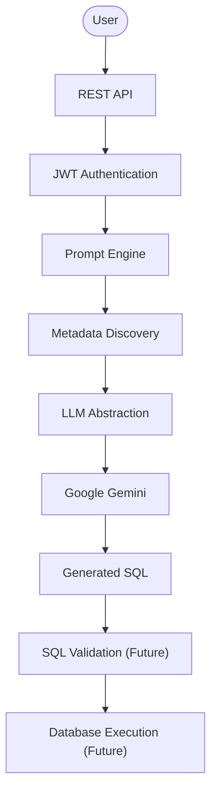
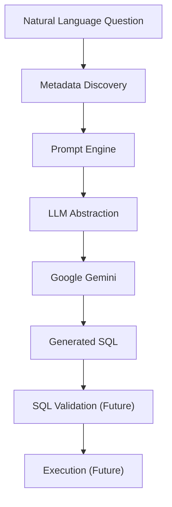
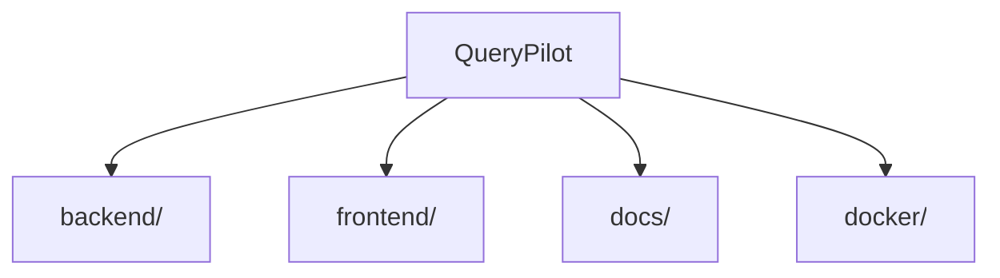

# QueryPilot

**Enterprise-grade, AI-powered Natural Language to SQL platform.**


QueryPilot lets users query relational databases in plain English. It is built on a modern Spring Boot backend designed around enterprise conventions — layered architecture, centralized error handling, JWT authentication, and a security-first foundation — with a metadata-aware prompt engineering layer and Google Gemini generating SQL directly from natural language questions.

---

## Why QueryPilot?

- **Natural language to SQL** — describe the data you want, and QueryPilot generates the SQL for you.
- **AI-powered generation** — a metadata-aware Prompt Engine and Google Gemini turn plain English into SQL, not hand-written templates.
- **PostgreSQL-aware** — SQL is grounded in real, live-discovered database metadata, not assumed schema.
- **Enterprise architecture** — a conventional, layered Spring Boot structure that scales with the team.
- **Secure by design** — JWT authentication protects every endpoint beyond registration and login.
- **Extensible core** — infrastructure (responses, exceptions, security, constants, the LLM abstraction) is built once and reused by every feature that follows.

---

## Features

### Implemented

| Area | Capability |
|---|---|
| ✔ | Java 21 / Spring Boot 3 REST API |
| ✔ | Enterprise package structure (`client`, `config`, `service`, `security`, `exception`, …) |
| ✔ | Spring Security foundation (stateless, CSRF-disabled filter chain) |
| ✔ | JWT authentication |
| ✔ | User registration |
| ✔ | User login |
| ✔ | Global exception handling (`@RestControllerAdvice`) |
| ✔ | Generic API response envelope |
| ✔ | PostgreSQL metadata discovery |
| ✔ | Prompt Engine (metadata-aware prompt construction) |
| ✔ | Google Gemini integration |
| ✔ | AI-powered SQL generation |

### Planned

| Area | Capability |
|---|---|
| ○ | SQL validation |
| ○ | SQL execution |
| ○ | Query history |
| ○ | Dashboard |
| ○ | Frontend |
| ○ | Docker deployment |

---

## Current Capabilities

QueryPilot's backend can currently:

- Authenticate users with JWT-based access tokens.
- Register and manage user accounts.
- Discover PostgreSQL database metadata (schemas, tables, columns, keys) at runtime.
- Generate metadata-aware, structured prompts for SQL generation.
- Generate SQL from natural language questions using Google Gemini.
- Talk to LLM providers through a provider-neutral `LLMClient` abstraction, so adding or swapping a provider requires no changes to calling services.
- Serve every capability through a consistent, JWT-secured REST API with a uniform response envelope.

---

## High-Level Architecture



Every stage through Generated SQL is implemented today; SQL Validation and Database Execution are the next milestones on the [roadmap](#development-roadmap) — see [Features](#features) for current status.

---

## AI Query Generation Pipeline



A user's question is paired with live PostgreSQL metadata (schemas, tables, columns, keys) by the Prompt Engine, which assembles a structured, metadata-grounded prompt. That prompt is submitted through the provider-neutral `LLMClient` abstraction — implemented today by `GeminiClient` — and the SQL Google Gemini returns is handed back as-is. Nothing in this pipeline validates or executes the SQL yet.

---

## Repository Structure



| Folder | Purpose |
|---|---|
| [`backend/`](backend/README.md) | Spring Boot backend — application code, configuration, and tests |
| `frontend/` | Client application (not yet started) |
| `docs/` | Project documentation — HLD, LLD, API reference, roadmap (added incrementally) |
| `docker/` | Container and deployment configuration (not yet started) |

### Backend Package Layout

`backend/src/main/java/com/querypilot/`

| Package | Responsibility |
|---|---|
| `client` | Outbound clients for external integrations — `LLMClient` / `GeminiClient`, `MetadataClient` / `PostgresMetadataClient` |
| `config` | Spring configuration and `@ConfigurationProperties` (JWT, Gemini) |
| `constant` | Centralized application, API, and security constants |
| `controller` | REST controllers (`AuthController`, `MetadataController`, `PromptController`, `QueryController`) |
| `dto` | Request/response DTOs, kept provider- and layer-neutral |
| `entity` | JPA entities |
| `exception` | Custom exceptions and the global `@RestControllerAdvice` handler |
| `mapper` | Entity ↔ DTO mapping |
| `prompt` | Prompt construction logic for the Prompt Engine |
| `repository` | Spring Data JPA repositories |
| `security` | Spring Security configuration and the JWT filter chain |
| `service` | Business logic interfaces and implementations |
| `util` | Shared utilities |

See [`backend/README.md`](backend/README.md) for the backend's internal package layout, configuration, and run instructions.

---

## Technology Stack

**Backend**

| Concern | Choice |
|---|---|
| Language | Java 21 |
| Framework | Spring Boot |
| Security | Spring Security |
| Persistence | Spring Data JPA |

**Database**

| Concern | Choice |
|---|---|
| Primary | PostgreSQL |
| Testing | H2 (in-memory) |

**Authentication**

| Concern | Choice |
|---|---|
| Mechanism | JWT |

**AI**

| Concern | Choice |
|---|---|
| Provider | Google Gemini |

**Build**

| Concern | Choice |
|---|---|
| Tool | Maven |

---

## Development Roadmap

**Completed**

- ✓ Sprint 1.1 – Foundation
- ✓ Sprint 1.2 – Infrastructure
- ✓ Sprint 1.3 – User Management
- ✓ Sprint 1.4 – Authentication
- ✓ Sprint 1.5 – JWT Authentication
- ✓ Sprint 1.6 – Metadata Discovery
- ✓ Sprint 1.7 – Prompt Engine
- ✓ Sprint 1.8 – Gemini Integration

**Upcoming**

- Sprint 1.9 – SQL Validation
- Sprint 2.0 – SQL Execution
- Sprint 2.x – Query History
- Sprint 2.x – Dashboard
- Sprint 2.x – Frontend
- Sprint 2.x – Deployment

---

## Project Status

**Current version:** v1.8.0
**Progress:** ~55% complete

The backend platform is largely complete: authentication, metadata discovery, prompt engineering, and AI-powered SQL generation are implemented and working end-to-end. The AI generation pipeline — Prompt Engine → LLM Abstraction → Google Gemini — is fully operational. SQL validation and SQL execution are the next major milestones, followed by query history, a dashboard, and a frontend.

---

## Documentation

Project documentation lives in [`docs/`](docs/). Detailed material — High-Level Design, Low-Level Design, API reference, security model, deployment guide, and roadmap — will be added gradually as development progresses.

---

## Getting Started

```sh
# Clone the repository
git clone https://github.com/the-illuminatus/Spring_backend_based_NLP-AI.git
cd Spring_backend_based_NLP-AI/backend

# Build
mvn clean install

# Run
mvn spring-boot:run
```

For configuration, environment variables, and database setup, see [`backend/README.md`](backend/README.md).

---

## Contributing

Contributions are welcome. If you're interested in helping shape QueryPilot, please open an issue to discuss the change before submitting a pull request.

---

## License

Distributed under the MIT License.
