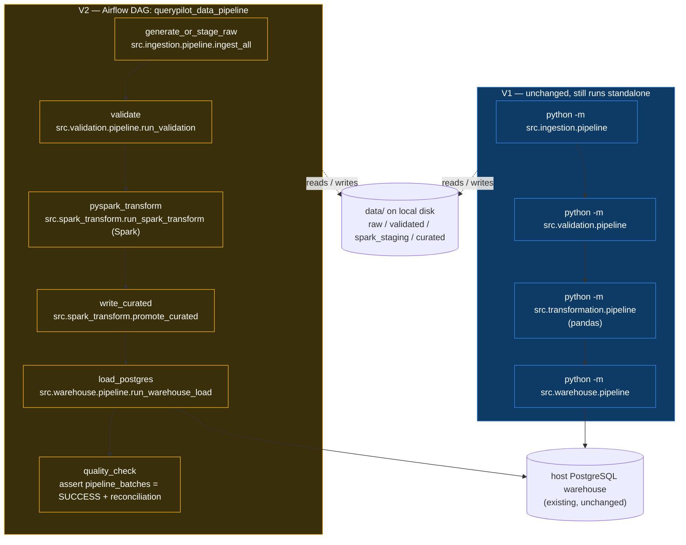

# V2 — Airflow-orchestrated PySpark pipeline

> **Status:** foundation. Additive to V1. V1 is unchanged and still runs
> standalone with its existing dependencies and commands.

V2 keeps every V1 guarantee and swaps two things in for the pipeline's
heavy middle:

| Concern | V1 | V2 |
|---|---|---|
| Orchestration | run the four `python -m` stages by hand | **Apache Airflow** DAG `querypilot_data_pipeline` (LocalExecutor, one container) |
| Transformation | `src/transformation` (pandas) | **PySpark** (`src/spark_transform`) — explicit schemas, joins, filters, aggregation |
| Storage | local filesystem (`data/`) | **local filesystem (`data/`)** — unchanged |
| Warehouse | host PostgreSQL | **host PostgreSQL** — unchanged, same loader |
| Dashboard / NL2SQL | as-is | as-is (they read the warehouse; nothing changed) |

**No S3. No object storage. No cloud services. No MinIO, EMR, Databricks,
Kubernetes, CeleryExecutor, Kafka, or RabbitMQ.** Airflow orchestrates;
PySpark transforms; PostgreSQL is the warehouse; the local disk is the
raw/curated store.

---

## Architecture



### What Spark actually does (`src/spark_transform/transform.py`)

Not an import-Spark-then-go-to-pandas shim. Per batch:

1. **Explicit schemas** — every validated CSV is read with a declared
   `StructType` (`schemas.READ_SCHEMAS`), no `inferSchema`.
2. **Type casting** — strings → `date` / `int` / `double`, explicitly.
3. **Referential `left_semi` joins** — orders filtered to surviving
   customers; `order_items` filtered to surviving orders *and* products;
   payments filtered to surviving orders. The curated set is internally
   consistent by construction (defence in depth on top of V1 validation).
4. **Row filters** — numeric-domain rules (`quantity > 0`,
   `unit_price > 0`, `amount >= 0`, valid status/method enums).
5. **Derived column** — `order_items.line_total = round(quantity * unit_price, 2)`.
6. **Group-by aggregation** — `SUM(line_total)` per `order_id`, joined
   back onto orders to produce `calculated_total_amount`,
   `total_amount_difference`, and the `total_amount_reconciled` flag
   (tolerance `0.01`, identical to V1's
   `src/transformation/business.py`).

Only the final, already-reduced frames are converted to pandas for the
single-file Parquet sink — V1's curated contract is one `data.parquet`
per entity, not a Spark part-file directory.

### The two Spark tasks

`pyspark_transform` runs the Spark job and writes neutral staging Parquet
to `data/spark_staging/batch_id=<id>/`. `write_curated` reads that with
pandas and writes the canonical `data/curated/batch_id=<id>/<entity>/data.parquet`
layout **using V1's own `src/transformation/writer.py` and
`src/transformation/report.py`**, so the curated output and
`transformation_report.json` are the same shape V1 produces. The report
gets one extra key, `"engine": "pyspark"`.

Result: the existing `src/warehouse` loader and the existing dashboard
consume a V2-produced batch with **zero code changes**. Verified — a V2
curated batch is byte-equivalent to the V1 pandas output for the same
input (`pandas.testing.assert_frame_equal` passes for all five entities).

---

## Running V2

### Prerequisites

- Docker Desktop (or Docker Engine + Compose v2).
- The existing PostgreSQL **warehouse** running on the host, with the
  `dataeng_warehouse` database created (same as V1 — see the main README).

### Start Airflow

```bash
cp orchestration/.env.airflow.example orchestration/.env.airflow
#   -> set POSTGRES_PASSWORD (and POSTGRES_USER if not "postgres")

docker compose -f docker-compose.airflow.yml up -d --build
# first build downloads the Airflow image + installs pyspark: a few minutes
```

Open <http://localhost:8080> — log in `admin` / `admin`.

### Trigger the pipeline

Un-pause **`querypilot_data_pipeline`** and click ▶ (Trigger DAG). The six
tasks run in order. `pyspark_transform` starts a local `SparkSession`
inside the task process (LocalExecutor → same container).

### Stop

```bash
docker compose -f docker-compose.airflow.yml down          # keep metadata
docker compose -f docker-compose.airflow.yml down -v       # wipe metadata db
```

### Notes

- **Warehouse connection.** The DAG's `load_postgres` / `quality_check`
  tasks reach the host PostgreSQL at `host.docker.internal` (set in
  `orchestration/.env.airflow`). On Linux hosts the compose file already adds
  the `host-gateway` mapping.
- **arm64 hosts.** The Dockerfile pins the amd64 JDK path. On Apple
  Silicon / arm64, override `JAVA_HOME` to
  `/usr/lib/jvm/java-17-openjdk-arm64` in `docker-compose.airflow.yml`.
- **Metadata DB.** A dedicated `postgres:16-alpine` container, not
  exposed to the host, used only by Airflow. It is not the warehouse.

---

## Running the Spark path without Airflow

For development and CI, the Spark transformation runs standalone:

```bash
pip install -r requirements-dev.txt        # adds pyspark; needs a local JDK 17+
python -m src.spark_transform.pipeline --batch-id <BATCH_ID>       # stage + promote
python -m src.spark_transform.pipeline --batch-id <BATCH_ID> --stage-only
python -m src.spark_transform.pipeline --batch-id <BATCH_ID> --promote-only
```

`<BATCH_ID>` must already have validation output (`data/validated/batch_id=<id>/`).
A full local V2 run without Airflow:

```bash
python -m src.ingestion.pipeline                       # prints BATCH_ID
python -m src.validation.pipeline     --batch-id <BATCH_ID>
python -m src.spark_transform.pipeline --batch-id <BATCH_ID>
python -m src.warehouse.pipeline      --batch-id <BATCH_ID>
```

### Windows / JDK 21 note

`src/spark_transform/session.py` sets the `--add-opens` flags Spark 3.5
needs on JDK 17+ and pins `PYSPARK_PYTHON` to the current interpreter
(Windows otherwise launches the Store `python` shim). It also keeps the
Parquet **sink** on pandas + PyArrow, so a local Windows run does **not**
need `winutils.exe` / `HADOOP_HOME` (Spark's native Hadoop file-output
committer is never invoked). Spark compute — reads, joins, the
aggregation — runs natively.

---

## Tests

```bash
pytest tests/test_spark_transform.py
```

Covers the read schemas, the curated output contract, `line_total`, the
reconciliation aggregation and its tolerance, referential semi-join
filtering across entities, numeric-domain filtering, and an end-to-end
`run_spark_transform` → `promote_curated` producing loader-ready curated
Parquet. The whole module **skips cleanly** if PySpark or a working local
JVM is absent (same pattern V1 uses for its PostgreSQL tests), so the
V1 suite still passes on a machine without Java.

A DAG-import smoke test lives in `tests/test_airflow_dag.py`; it skips
unless `apache-airflow` is importable (it isn't in the V1 env — it runs
inside the Airflow image).

---

## What this is not

- Not a production Spark cluster. `local[*]` master, one process.
- No distributed-scale or performance claims — the dataset is thousands
  of rows; Spark here demonstrates the *engineering pattern* (explicit
  schemas, joins, aggregations, partition-aware I/O), not throughput.
- Not a replacement for V1. V1's pandas transformation path is intact and
  independently runnable.
